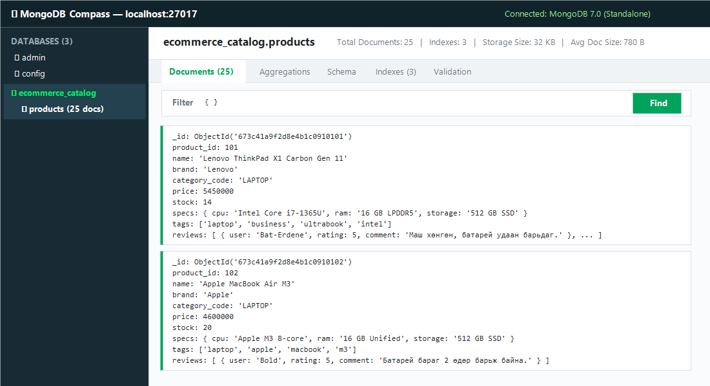
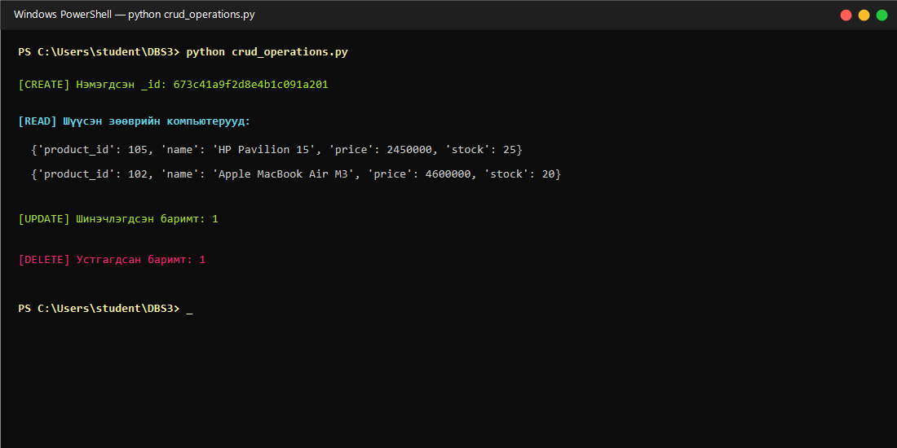
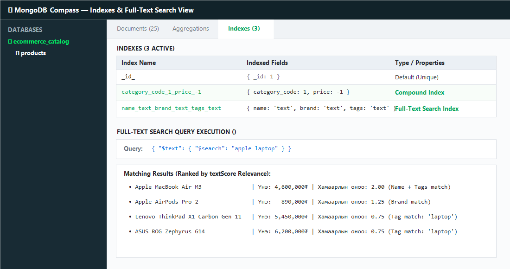
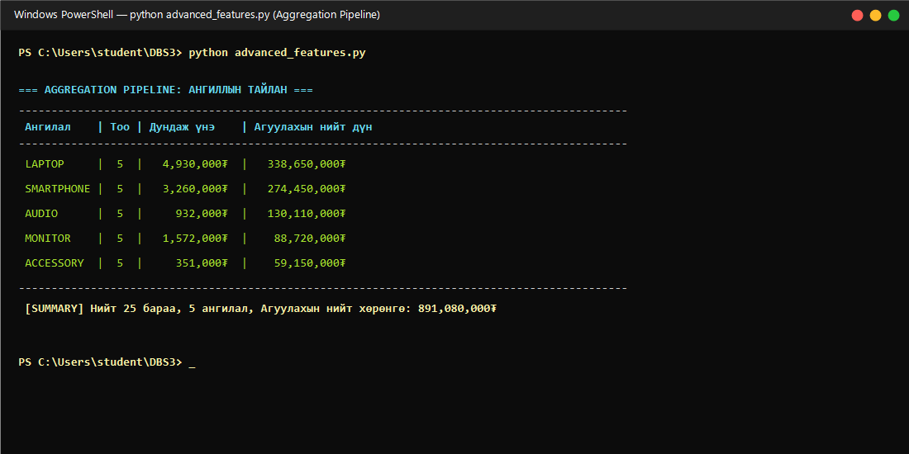

# БИЕ ДААЛТЫН АЖИЛ №3
## NoSQL өгөгдлийн сангууд: Онол, Загварчлал, Хэрэглээ ба Туршилтын төсөл
### Цахим худалдааны бүтээгдэхүүний каталогийн системийг MongoDB платформ дээр хэрэгжүүлсэн судалгааны тайлан

**Гүйцэтгэсэн оюутан:** [Оюутны овог, нэр] &nbsp;&nbsp;&nbsp;&nbsp;&nbsp;&nbsp;&nbsp;&nbsp; **Оюутны код:** [Оюутны код]  
**Анги, бүлэг:** [Анги, бүлэг] &nbsp;&nbsp;&nbsp;&nbsp;&nbsp;&nbsp;&nbsp;&nbsp;&nbsp;&nbsp;&nbsp;&nbsp;&nbsp;&nbsp;&nbsp;&nbsp;&nbsp;&nbsp;&nbsp;&nbsp;&nbsp;&nbsp;&nbsp;&nbsp;&nbsp;&nbsp;&nbsp;&nbsp;&nbsp;&nbsp;&nbsp;&nbsp; **Шалгасан багш:** [Багшийн нэр]  
**Сонгосон систем:** MongoDB (Document Store) &nbsp;&nbsp;&nbsp;&nbsp; **Огноо:** 2026 он  

---

> **Ажлын зорилго ба товч агуулга:** Энэхүү бие даалтын ажил нь орчин үеийн их хэмжээний өгөгдөл боловсруулах шаардлагад нийцүүлэн үүссэн NoSQL өгөгдлийн сангуудын онолын үндэс, дөрвөн үндсэн төрлийн архитектурын ялгаа, CAP теоремийн практик ач холбогдол болон өгөгдөл загварчлалын зарчмыг системтэйгээр судлахад чиглэнэ. Онолын судалгаанд тулгуурлан MongoDB платформ болон Python (PyMongo) орчинд цахим худалдааны бүтээгдэхүүний каталогийн туршилтын системийг загварчлан байгуулж, CRUD үйлдлүүд, индексжүүлэлт, текст хайлт болон Aggregation Pipeline-ийн дэвшилтэт боломжуудыг туршин, хамааралт (SQL) системтэй харьцуулсан дүн шинжилгээ хийв.

---

## 1. Онолын судалгааны хэсэг

### 1.1. SQL ба NoSQL — Суурь ойлголт

Өгөгдлийн сангийн удирдлагын системүүд (DBMS) нь програм хангамжийн инженерчлэлийн суурь дэд бүтэц болж ирсэн. 1970 онд Эдгар Коддын боловсруулсан хамааралт загвар (Codd, 1970) нь өгөгдлийг мөр, баганаас бүрдэх хүснэгт хэлбэрээр зохион байгуулж, хүснэгт хоорондын холбоосыг гадаад түлхүүр (Foreign Key)-ээр илэрхийлэх замаар өгөгдлийн давхардлыг бууруулж, бүрэн бүтэн байдлыг баталгаажуулсан юм. Энэхүү зарчим дээр суурилсан RDBMS (Relational Database Management System — жишээ нь PostgreSQL, MySQL, Oracle, MS SQL Server) нь SQL (Structured Query Language) хэл ашиглан хатуу тодорхойлсон схем (Schema-on-Write) болон ACID (Atomicity, Consistency, Isolation, Durability) гүйлгээний баталгааг хангадаг.

Гэвч 2000-аад оны дунд үеэс интернэт хэрэглэгчдийн тоо огцом өсөж, нийгмийн сүлжээ, цахим худалдаа, үүлэн тооцоолол болон IoT төхөөрөмжүүдээс секунд тутамд асар их хэмжээний бүтэцгүй болон хагас бүтэцтэй өгөгдөл (Big Data) үүсэх болсон. Уламжлалт RDBMS архитектур нь дараах гурван үндсэн сорилттой тулгарсан (Sadalage & Fowler, 2012):

- **Хэвтээ өргөтгөлийн хязгаарлалт (Horizontal Scaling):** Хамааралт өгөгдлийн сан нь хүснэгт хоорондын `JOIN` үйлдэл болон ACID гүйлгээг хадгалахын тулд ихэвчлэн нэг хүчирхэг серверийн хүчин чадлыг нэмэгдүүлэх буюу босоо өргөтгөлт (Vertical Scaling / Scale-up) хийдэг. Энэ нь өртөг өндөртэй бөгөөд техник хангамжийн физик хязгаарт тулдаг. Харин NoSQL нь олон энгийн серверийн кластерт өгөгдлийг тараан байрлуулах (Scale-out) зарчмаар бүтээгдсэн.
- **Схемийн уян хатан бус байдал:** Бизнесийн шаардлага хурдан өөрчлөгддөг орчин үеийн веб системүүдэд өгөгдлийн бүтэц байнга шинэчлэгддэг. Сая сая бичлэгтэй SQL хүснэгтэд `ALTER TABLE` хийх нь системийг удаашруулах эсвэл зогсолт (downtime) үүсгэх эрсдэлтэй.
- **Их хэмжээний өгөгдөл ба тархсан системийн хэрэгцээ:** Өндөр ачаалалтай системүүдэд секундийн мянганы нарийвчлалтай хариу үйлдэл (low latency), тасралтгүй ажиллагаа (high availability), газарзүйн олон бүсэд өгөгдөл хуулах (geo-replication) чадвар шаардагддаг. NoSQL нь ACID-ийн хатуу шаардлагыг тодорхой хэмжээнд сулруулж, BASE (Basically Available, Soft state, Eventual consistency) загварыг нэвтрүүлснээр тархсан орчинд өндөр гүйцэтгэл гаргах боломжийг олгодог (Kleppmann, 2017).

| Шалгуур үзүүлэлт | SQL (RDBMS) | NoSQL (Non-Relational) |
| :--- | :--- | :--- |
| **Өгөгдлийн загвар** | Хүснэгт, мөр, багана; хатуу хамаарал ба нормалчлал | Баримт (JSON/BSON), түлхүүр-утга, өргөн багана эсвэл граф |
| **Схем (Schema)** | Урьдчилан хатуу тодорхойлсон (Static / Schema-on-Write) | Уян хатан, динамик (Dynamic / Schema-on-Read) |
| **Өргөтгөлт (Scaling)** | Голчлон босоо өргөтгөлт (CPU, RAM нэмэх) | Хэвтээ өргөтгөлт (олон сервер нэмж кластер болгох) |
| **Гүйлгээний баталгаа** | Хатуу ACID (Atomicity, Consistency, Isolation, Durability) | Ихэвчлэн BASE (зарим системд олон баримтын ACID дэмждэг) |
| **Хүсэлтийн хэл** | Стандартчилагдсан SQL | Систем бүрт өвөрмөц API, JSON query, CQL, Cypher гэх мэт |
| **Тохиромжтой хэрэглээ** | Санхүү, банк, нягтлан бодох бүртгэл, ERP систем | Цахим худалдаа, нийгмийн сүлжээ, IoT, кэш, бодит цагийн аналитик |

---

### 1.2. NoSQL системүүдийн 4 үндсэн төрөл

NoSQL өгөгдлийн сангууд нь нэгдмэл ганц архитектур биш бөгөөд өгөгдлийг хадгалах, индексжүүлэх болон хандах аргачлалаасаа хамааран дөрвөн үндсэн төрөлд ангилагддаг (Sadalage & Fowler, 2012):

#### 1) Key-Value Store (Түлхүүр-утга хадгалагч)
- **Архитектурын онцлог ба өгөгдлийн бүтэц:** Хамгийн энгийн бүтэцтэй NoSQL төрөл бөгөөд өгөгдлийг хэш хүснэгт (hash table) буюу өвөрмөц түлхүүр (key) ба түүнд харгалзах дурын утгын (value — тэмдэгт мөр, JSON, хоёртын өгөгдөл) хослол хэлбэрээр хадгалдаг. Систем нь утгын дотоод бүтцийг задлан шалгах шаардлагагүй тул санах ойд (in-memory) эсвэл диск дээр $O(1)$ хугацааны нарийвчлалтайгаар маш хурдан уншилт, бичилт хийдэг.
- **Давуу тал:** Маш өндөр хурд (sub-millisecond latency), энгийн API (`GET`, `SET`, `DELETE`), хэвтээ өргөтгөлт хийхэд хялбар.
- **Сул тал:** Утгын дотоод талбараар шүүлтүүр хийх, нарийн төвөгтэй нэгтгэл (aggregation) болон холбоост хайлт гүйцэтгэх боломж хязгаарлагдмал.
- **Түгээмэл хэрэгжүүлэлтүүд:** Redis, Amazon DynamoDB, Memcached, Riak.
- **Бодит жишээ:** Хэрэглэгчийн сесс (session) хадгалах, цахим худалдааны сагс (shopping cart), вэб хуудасны кэшлэлт (caching), тоглоомын онооны самбар (leaderboard).

#### 2) Document Store (Баримтад суурилсан өгөгдлийн сан)
- **Архитектурын онцлог ба өгөгдлийн бүтэц:** Key-Value загварыг өргөтгөсөн хэлбэр бөгөөд утга хэсэг нь JSON, BSON эсвэл XML форматаар бичигдсэн хагас бүтэцтэй баримт (document) байна. Өгөгдлийн сан нь баримтын дотоод бүтцийг ойлгодог тул шаталсан талбар (nested fields) болон массив (arrays) дээр индекс үүсгэж, нарийн шүүлтүүр, эрэмбэлэлт, нэгтгэлийн хүсэлт ажиллуулах чадвартай. Ижил зориулалттай баримтууд цуглуулгад (collection) нэгтгэгдэнэ.
- **Давуу тал:** Объект хандалтат програмчлалын өгөгдлийн бүтэцтэй шууд нийцдэг (ORM-ийн хүндрэлгүй), уян хатан схемтэй, баримт доторх бүх талбараар хайлт хийх боломжтой.
- **Сул тал:** Олон цуглуулга дамнасан нарийн `JOIN` үйлдэл хийхэд гүйцэтгэл буурдаг; өгөгдлийг давхардуулан хадгалснаар (denormalization) шинэчлэлтийн үед зөрүү гарах эрсдэлтэй.
- **Түгээмэл хэрэгжүүлэлтүүд:** MongoDB, CouchDB, Firebase Firestore, Amazon DocumentDB.
- **Бодит жишээ:** Цахим худалдааны бүтээгдэхүүний каталог, контент удирдлагын систем (CMS), хэрэглэгчийн профайл, мобайл аппликейшний өгөгдөл хадгалалт.

#### 3) Column-Family Store (Өргөн баганын өгөгдлийн сан)
- **Архитектурын онцлог ба өгөгдлийн бүтэц:** Google-ийн Bigtable судалгаанд суурилсан энэхүү төрөл нь өгөгдлийг мөр бүрээр бус, баганын бүлгээр (column family) хадгалдаг. Нэг мөр (row key) нь сая сая динамик багана агуулж болох ба хоосон багана диск дээр зай эзэлдэггүй. Тархсан кластерийн бүх зангилаа ижил эрхтэй (peer-to-peer / masterless) ажиллах тул нэг цэгийн доголдол (single point of failure) үүсдэггүй.
- **Давуу тал:** Петабайт хэмжээний өгөгдөл дээр маш өндөр хурдтай бичилт (write-heavy workload), өгөгдлийг үр ашигтай шахах, газарзүйн олон дата төвд тасралтгүй ажиллах чадвар.
- **Сул тал:** Хүсэлтийн хэв маягийг (query pattern) урьдчилан нарийн төлөвлөж хүснэгтийн түлхүүрээ зохиох шаардлагатай; дурын баганаар шүүлт хийх болон гүйлгээ (transaction) хийхэд тохиромжгүй.
- **Түгээмэл хэрэгжүүлэлтүүд:** Apache Cassandra, Apache HBase, ScyllaDB, Google Cloud Bigtable.
- **Бодит жишээ:** IoT мэдрэгчийн цагийн цуваа (time-series) өгөгдөл, системийн лог бүртгэл, стриминг үйлчилгээний үзэлтийн түүх (Netflix), мессежийн архив.

#### 4) Graph Database (Граф өгөгдлийн сан)
- **Архитектурын онцлог ба өгөгдлийн бүтэц:** Математикийн графын онолд суурилж, өгөгдлийн объектуудыг орой (Node / Vertex), тэдгээрийн хоорондын холбоосыг ирмэг (Edge / Relationship), шинж чанарыг атрибут (Property) хэлбэрээр хадгалдаг. Холбоосыг физик түвшинд шууд заагчаар хадгалдаг (index-free adjacency) тул олон шатлалт хамаарлыг (жишээ нь найзын найзын найз) хайхад SQL-ийн `JOIN`-оос хэдэн зуу дахин хурдан ажилладаг.
- **Давуу тал:** Нарийн төвөгтэй сүлжээн хамаарлыг илэрхийлэх, богино зам олох, хэв шинж илрүүлэхэд хамгийн өндөр гүйцэтгэлтэй.
- **Сул тал:** Их хэмжээний графыг олон серверт хувааж байрлуулах (sharding) нь техникийн хувьд хамгийн төвөгтэй; бөөнөөр нь өгөгдөл унших тайлангийн үйлдэлд тохиромж муутай.
- **Түгээмэл хэрэгжүүлэлтүүд:** Neo4j, ArangoDB, Amazon Neptune, JanusGraph.
- **Бодит жишээ:** Нийгмийн сүлжээний найз санал болгох систем, банкны луйвар илрүүлэх (fraud detection), бүтээгдэхүүний зөвлөмжийн систем (recommendation engine), мэдлэгийн граф.

| NoSQL төрөл | Өгөгдлийн бүтэц | Түгээмэл системүүд | Хамгийн оновчтой хэрэглээ |
| :--- | :--- | :--- | :--- |
| **Key-Value** | Түлхүүр → Утга (Hash map) | Redis, DynamoDB, Memcached | Кэшлэлт, хэрэглэгчийн сесс, сагс, хурдан тоолуур |
| **Document** | JSON / BSON баримт, цуглуулга | MongoDB, CouchDB, Firestore | Бүтээгдэхүүний каталог, CMS, профайл, API backend |
| **Column-Family** | Мөрийн түлхүүр → Баганын бүлэг | Cassandra, HBase, ScyllaDB | IoT мэдрэгч, цагийн цуваа, лог, өндөр бичилттэй систем |
| **Graph** | Орой (Node) + Ирмэг (Edge) | Neo4j, ArangoDB, Neptune | Нийгмийн сүлжээ, луйвар илрүүлэх, зөвлөмжийн систем |

---

### 1.3. CAP Теорем — Дэлгэрэнгүй тайлбар

Эрик Брюэрийн 2000 онд дэвшүүлж (Brewer, 2000), Сет Гилберт болон Нэнси Линч нарын 2002 онд математикаар баталсан (Gilbert & Lynch, 2002) CAP теорем нь тархсан өгөгдлийн сангийн архитектур зохиох үндсэн хууль юм. Энэхүү теорем ёсоор тархсан өгөгдлийн систем нь доорх гурван шинж чанараас нэгэн зэрэг хамгийн ихдээ хоёрыг нь л бүрэн хангаж чадна:

- **Consistency (Тогтвортой байдал — C):** Кластерийн аль ч зангилаанаас уншилт хийхэд хамгийн сүүлд амжилттай бичигдсэн өгөгдөл эсвэл алдааны мэдэгдэл буцаах шинж чанар. Өөрөөр хэлбэл бүх хэрэглэгч нэг ижил агшинд ижил өгөгдөл харна.
- **Availability (Хүртээмжтэй байдал — A):** Ажиллаж буй зангилаанд ирсэн хүсэлт бүрд (хамгийн сүүлийн өгөгдөл биш байсан ч) алдаа буцаахгүйгээр боломжит хугацаанд хариу өгөх шинж чанар.
- **Partition Tolerance (Сүлжээний тасралтыг тэсвэрлэх чадвар — P):** Кластерийн зангилаануудын хоорондох сүлжээний холбоо тасрах эсвэл саатах (network partition) үед ч систем бүхэлдээ унахгүйгээр ажиллагаагаа үргэлжлүүлэх чадвар.

Бодит тархсан системд сүлжээний саатал гарах нь зайлшгүй тул **P (Partition Tolerance) нь сонголт бус заавал хангах нөхцөл** байдаг (Brewer, 2012). Иймээс сүлжээний тасралт үүссэн үед архитектурын түвшинд CP эсвэл AP чиглэлийн аль нэгийг сонгох шаардлагатай болдог:

- **CA (Consistency + Availability):** Сүлжээний тасралт гарахгүй нэг зангилаатай орчинд л бүрэн биелнэ. Уламжлалт дан серверийн RDBMS (PostgreSQL, MySQL) энэ ангилалд хамаардаг.
- **CP (Consistency + Partition Tolerance):** Өгөгдлийн нарийвчлал хамгийн чухал үед сонгоно. Сүлжээ тасрахад зөрүүтэй өгөгдөл гаргахгүйн тулд зарим зангилааны бичилт эсвэл уншилтыг түр хаадаг. Жишээ нь: банкны үлдэгдэл, барааны нөөцийн захиалга. *Бодит системүүд:* MongoDB (анхдагч тохиргоогоор), HBase, Redis (кластерын хатуу тохиргоо), Neo4j (Causal Clustering).
- **AP (Availability + Partition Tolerance):** Систем хэзээ ч зогсохгүй байх нь түр зуурын өгөгдлийн зөрүүнээс илүү чухал үед сонгоно. Сүлжээ сэргэхэд зангилаанууд өгөгдлөө ижилсүүлдэг (Eventual Consistency). Жишээ нь: нийгмийн сүлжээний пост, барааны сэтгэгдэл, стриминг үзэлтийн түүх. *Бодит системүүд:* Apache Cassandra, Amazon DynamoDB (тохируулгаас хамааран CP/AP), CouchDB.

| Ангилал | Сүлжээ тасрах үеийн төлөв | Жишээ системүүд | Сонгох бизнесийн нөхцөл |
| :--- | :--- | :--- | :--- |
| **CA** | Тархсан сүлжээний тасралтыг тэсвэрлэхгүй (дан сервер) | PostgreSQL, MySQL, Oracle (single-node) | Дотоод байгууллагын систем, хатуу ACID шаардлага |
| **CP** | Тогтвортой байдлыг хадгалж, салангид зангилааг түр хязгаарлана | MongoDB, HBase, Neo4j, ZooKeeper | Төлбөр тооцоо, нөөцийн удирдлага, хэрэглэгчийн эрх |
| **AP** | Бүх хүсэлтэд хариулж, сүүлд нь өгөгдлөө ижилсүүлнэ | Cassandra, DynamoDB, CouchDB, Riak | Сошиал контент, аналитик, каталог, дэлхийн хэмжээний сервис |

---

### 1.4. NoSQL-ийн өгөгдлийн загварчлал

Хамааралт өгөгдлийн санд өгөгдлийг эхлээд нормалчилж (3NF), дараа нь хэрэгцээтэй хүсэлтээ бичдэг бол NoSQL-д **хэрэглээний хүсэлтийн хэв маягт (Query-Driven Modeling)** тулгуурлан өгөгдлийн бүтцээ төлөвлөдөг (MongoDB Manual). Гол ойлголтууд нь:

- **Schema-less буюу динамик схем:** Өгөгдлийн сан хатуу бүтэц тулгахгүй гэсэн үг боловч програм хангамжийн түвшинд логик бүтцийг (schema validation) мөрдөх нь чухал. Нэг цуглуулга дахь хоёр бүтээгдэхүүн өөр өөр техникийн үзүүлэлттэй байж болно (жишээ нь зөөврийн компьютерт `cpu`, `ram` байхад хувцаст `size`, `material` байна).
- **Documents vs Collections:** Document Store-д Document нь SQL-ийн мөртэй, Collection нь хүснэгттэй дүйцнэ. Гэхдээ баримт нь дотроо шаталсан дэд объект болон массив агуулдаг тул SQL-ийн олон хүснэгтийн мэдээллийг нэг цул нэгжид багтаах чадвартай.
- **Wide-Column загвар:** Cassandra зэрэг системд өгөгдлийг Partition Key болон Clustering Key-ээр зохион байгуулдаг. Partition Key нь өгөгдөл аль зангилаанд хадгалагдахыг, Clustering Key нь тухайн хэсэг дотор ямар дарааллаар эрэмбэлэгдэхийг тодорхойлно.
- **Relationship Modeling — Embedding vs Referencing:**
  - *Embedding (Шигтгэх / Denormalization):* Холбоотой өгөгдлийг үндсэн баримтын дотор дэд объект эсвэл массив хэлбэрээр хадгалах (жишээ нь бүтээгдэхүүний дотор үзүүлэлт `specs` болон сүүлийн сэтгэгдлүүдийг шигтгэх). Нэг уншилтаар бүх мэдээллийг хурдан авах давуу талтай боловч баримтын хэмжээ хэт томрох (MongoDB-д 16MB хязгаартай) эсвэл өгөгдөл олон газар давтагдах сул талтай.
  - *Referencing (Холбоос хийх / Normalization):* Хоёр цуглуулгыг `_id` талбараар холбох (жишээ нь захиалга нь `product_id`-аар бүтээгдэхүүн рүү заах). Олон-олон (M:N) хамаарал болон байнга өөрчлөгддөг бие даасан өгөгдөлд тохиромжтой.
- **Indexes (Индексжүүлэлт):** Бүх баримтыг дараалан шалгах (Collection Scan) үйлдлээс зайлсхийж B-Tree бүтцээр хайлтыг хурдасгана. MongoDB нь дан талбарын (Single Field), нийлмэл (Compound), массивын (Multikey), текст хайлтын (Text) болон газарзүйн (Geospatial) индексийг дэмждэг.
- **Sharding ба Replication:** Replication нь өгөгдлийн хуулбарыг олон серверт (Replica Set: Primary + Secondary) хадгалснаар найдвартай ажиллагаа (High Availability) болон уншилтын ачаалал хуваах боломжийг олгодог. Sharding нь их хэмжээний өгөгдлийг Shard Key-ийн дагуу хэсэглэн олон кластерт хувааж, бичилт болон хадгалалтын багтаамжийг хэвтээ чиглэлд хязгааргүй өргөтгөх механизм юм (Kleppmann, 2017).

---

### 1.5. Том системүүдийн хэрэгжүүлэлт: Netflix ба Apache Cassandra

Дэлхийн тэргүүлэх стриминг платформ болох Netflix нь 200 гаруй сая хэрэглэгчийн үзэлтийн түүх, хаана зогсоосон хугацаа (bookmark), зөвлөмжийн өгөгдөл болон төхөөрөмжийн бүртгэлийг бодит цагт тасралтгүй боловсруулдаг. Анх уламжлалт хамааралт өгөгдлийн сан (Oracle) ашиглаж байсан боловч дата төвийн саатал болон өсөн нэмэгдэж буй трафикийг даах боломжгүй болсон тул 2011 оноос үүлэн орчин (AWS) болон **Apache Cassandra (Column-Family NoSQL)** руу бүрэн шилжсэн (Cockcroft & Sheahan, 2011).

Netflix-ийн хувьд Cassandra-г сонгосон гол шалтгаанууд нь: (1) *Masterless архитектур* — бүх зангилаа ижил эрхтэй тул нэг бүс нутгийн дата төв унасан ч хэрэглэгч кино үзэх үйлчилгээ огт тасрахгүй; (2) *Олон бүс нутгийн хуулбарлалт (Multi-region Replication)* — дэлхийн өнцөг булан бүрт байрлах хэрэглэгчдэд хамгийн ойрын серверээс өгөгдөл хүргэх; (3) *Шугаман хэвтээ өргөтгөлт* — AWS дээр хийсэн туршилтаар 288 зангилаатай Cassandra кластер секундэд 1.1 саяас дээш бичилт (write/sec) хийх чадвартай болох нь батлагдсан (Cockcroft & Sheahan, 2011). CAP теоремийн үүднээс Netflix нь хэрэглэгчийн үзэлтийн түүхийг **AP зарчмаар** (түр зуурын секундийн зөрүү байж болох ч үйлчилгээ хэзээ ч зогсохгүй) ажиллуулдаг нь бизнесийн зорилгодоо бүрэн нийцсэн шийдэл юм.

---

## 2. Практик туршилтын төсөл: Цахим худалдааны бүтээгдэхүүний каталог (MongoDB)

### 2.1. Системийн зорилго ба өгөгдлийн тодорхойлолт

Туршилтын төслийн хүрээнд **MongoDB (Document Store)** өгөгдлийн сан болон **Python (PyMongo)** програмчлалын хэлийг ашиглан **Цахим худалдааны бүтээгдэхүүний каталогийн систем (E-Commerce Product Catalog)**-ийг зохион бүтээв. Цахим худалдааны платформд электрон бараа, гэр ахуйн цахилгаан хэрэгсэл, дагалдах хэрэгсэл, оффисын тавилга зэрэг олон төрлийн ангиллын бүтээгдэхүүн нэг дор байршдаг. Ангилал бүр ялгаатай техникийн үзүүлэлттэй (жишээ нь зөөврийн компьютерт процессор, RAM; чихэвчинд Bluetooth хувилбар, батарей; дэлгэцэнд нягтрал, хавтан) тул хатуу хүснэгтийн схемтэй SQL-ээс илүүтэйгээр уян хатан JSON баримт хадгалдаг MongoDB хамгийн оновчтой сонголт юм.

Системд дараах гурван үндсэн төрлийн өгөгдлийг боловсруулна:
1. **Бүтээгдэхүүний мэдээлэл (`products` collection):** Бүтээгдэхүүний код, нэр, ангилал, брэнд, үнэ (төгрөгөөр), үлдэгдэл тоо ширхэг, динамик техникийн үзүүлэлт (`specs` дэд объект), хайлтын түлхүүр үгс (`tags` массив), хэрэглэгчдийн сүүлийн үнэлгээнүүд (`reviews` шигтгэсэн массив) болон үүсгэсэн огноо.
2. **Ангиллын лавлах (`categories` collection):** Бүтээгдэхүүний үндсэн ангиллын нэр, тайлбар, эцэг ангиллын код.
3. **Захиалгын бүртгэл (`orders` collection):** Хэрэглэгчийн нэр, захиалсан бүтээгдэхүүнүүдийн жагсаалт (`product_id` холбоос, тоо ширхэг, нэгж үнэ), нийт дүн болон төлөв.

---

### 2.2. Өгөгдлийн загвар ба архитектурын зураглал

Өгөгдлийн загварыг боловсруулахдаа **эрлийз загварчлал (Hybrid Modeling: Embedding + Referencing)**-ыг ашиглав. Тухайлбал, бүтээгдэхүүний техникийн үзүүлэлт (`specs`) болон хэрэглэгчийн сэтгэгдлийг (`reviews`) бүтээгдэхүүний баримт дотор шууд шигтгэснээр (Embedding) бүтээгдэхүүний дэлгэрэнгүй хуудсыг ганц уншилтаар нээх боломжтой болсон. Харин ангилал болон захиалгын бүртгэлийг тусдаа цуглуулгад байршуулж, `category_code` болон `product_id` талбараар холбосон (Referencing).

```
┌─────────────────────────────────┐           ┌──────────────────────────────────────────────┐           ┌─────────────────────────────────┐
│           categories            │           │           products (Үндсэн баримт)           │           │             orders              │
├─────────────────────────────────┤           ├──────────────────────────────────────────────┤           ├─────────────────────────────────┤
│ _id: ObjectId (PK)              │           │ _id: ObjectId (PK)                           │           │ _id: ObjectId (PK)              │
│ category_code: String           │◄────1:N───┤ product_id: Int (Unique)                     ├───M:N────►│ order_no: String                │
│ name: String                    │           │ name, brand: String                          │           │ customer: String                │
│ description: String             │           │ category_code: String (Ref)                  │           │ items: [{product_id, qty}]      │
└─────────────────────────────────┘           │ price: Int, stock: Int                       │           │ total_price: Int                │
                                              │ tags: [String]                               │           │ status: String                  │
                                              │ specs: { ... } (Embedded: cpu, ram, storage) │           └─────────────────────────────────┘
                                              │ reviews: [ {...} ] (Embedded: user, rating)  │
                                              └──────────────────────────────────────────────┘
```
*Зураг 1. Цахим худалдааны каталогийн логик бүтэц (Embedding ба Referencing хосолсон загвар)*

Доорх JSON бүтэц нь `products` цуглуулгад хадгалагдах нэг бүтээгдэхүүний баримтын загвар схем (Document Schema) болно:

```json
{
  "product_id": 101,
  "name": "Lenovo ThinkPad X1 Carbon Gen 11",
  "brand": "Lenovo",
  "category_code": "LAPTOP",
  "price": 5450000,
  "stock": 14,
  "specs": {
    "cpu": "Intel Core i7-1365U",
    "ram": "16 GB LPDDR5",
    "storage": "512 GB NVMe SSD",
    "screen": "14 inch WUXGA"
  },
  "tags": ["laptop", "business", "ultrabook", "intel"],
  "reviews": [
    { "user": "Bat-Erdene", "rating": 5, "comment": "Маш хөнгөн, батарей удаан барьдаг." },
    { "user": "Sarnai", "rating": 4, "comment": "Гүйцэтгэл сайн боловч үнэ бага зэрэг өндөр." }
  ],
  "created_at": "2026-10-15T09:30:00Z"
}
```

```
┌─────────────────────────┐         ┌─────────────────────────┐         ┌─────────────────────────┐         ┌─────────────────────────┐
│     Хэрэглэгч / CLI     │         │     Python (PyMongo)    │         │     MongoDB Engine      │         │     Үр дүн / Тайлан     │
│   Хайлт, CRUD хүсэлт,   ├────────►│  JSON/BSON хөрвүүлэлт,  ├────────►│ • Index (Text, Compound)│────────►│      Шүүсэн жагсаалт,   │
│   Тайлангийн комманд    │         │   Баталгаажуулалт, API  │         │ • Aggregation Pipeline  │         │     Статистик нэгтгэл   │
└─────────────────────────┘         └─────────────────────────┘         │ • WiredTiger Storage    │         └─────────────────────────┘
                                                                        └─────────────────────────┘
```
*Зураг 2. Хэрэглэгчийн хүсэлтээс өгөгдлийн сангийн боловсруулалт хүртэлх өгөгдлийн урсгал*

---

### 2.3. Өгөгдлийн сан байгуулах ба өгөгдөл оруулах (25 баримт)

Туршилтын өгөгдлийн санг `ecommerce_catalog` нэртэйгээр үүсгэж, дотор нь `products` цуглуулгад 5 өөр ангиллын (LAPTOP, SMARTPHONE, AUDIO, ACCESSORY, MONITOR) нийт **25 ширхэг бүтээгдэхүүний баримтыг** бэлтгэн оруулав. Ангилал тус бүр өөрийн онцлогт тохирсон `specs` бүтэцтэй байгаа нь NoSQL-ийн уян хатан схемийн давуу талыг бодитоор харуулж байна.

| ID | Бүтээгдэхүүний нэр | Ангилал | Үнэ (₮) | Үлдэгдэл | Онцлог талбар |
| :--- | :--- | :--- | :--- | :--- | :--- |
| **101** | Lenovo ThinkPad X1 Carbon Gen 11 | LAPTOP | 5,450,000 | 14 | i7, 16GB RAM |
| **102** | Apple MacBook Air M3 | LAPTOP | 4,600,000 | 20 | M3, 16GB RAM |
| **103** | ASUS ROG Zephyrus G14 | LAPTOP | 6,200,000 | 8 | Ryzen 9, RTX 4060 |
| **104** | Dell XPS 15 9530 | LAPTOP | 5,950,000 | 10 | i7, OLED 3.5K |
| **105** | HP Pavilion 15 | LAPTOP | 2,450,000 | 25 | i5, 8GB RAM |
| **106** | iPhone 15 Pro 256GB | SMARTPHONE | 4,350,000 | 18 | A17 Pro, Titanium |
| **107** | Samsung Galaxy S24 Ultra | SMARTPHONE | 4,200,000 | 15 | S-Pen, 200MP |
| **108** | Google Pixel 8 Pro | SMARTPHONE | 3,150,000 | 12 | Tensor G3, AI Cam |
| **109** | Xiaomi 14 5G | SMARTPHONE | 2,650,000 | 22 | Leica Lens, 90W |
| **110** | OnePlus 12R | SMARTPHONE | 1,950,000 | 19 | 5500mAh, 120Hz |
| **111** | Sony WH-1000XM5 | AUDIO | 1,280,000 | 30 | ANC, 30h Battery |
| **112** | Apple AirPods Pro 2 | AUDIO | 890,000 | 40 | USB-C, H2 Chip |
| **113** | Bose QuietComfort Ultra | AUDIO | 1,420,000 | 16 | Spatial Audio |
| **114** | JBL Charge 5 Speaker | AUDIO | 580,000 | 28 | IP67, 20h Play |
| **115** | Marshall Major IV | AUDIO | 490,000 | 35 | 80h Wireless |
| **116** | Logitech MX Master 3S | ACCESSORY | 360,000 | 45 | 8000 DPI, Quiet |
| **117** | Keychron K2 Pro Keyboard | ACCESSORY | 390,000 | 24 | Hot-swap, RGB |
| **118** | Anker 737 PowerBank 24K | ACCESSORY | 440,000 | 32 | 140W PD Output |
| **119** | Samsung T7 Shield 1TB | ACCESSORY | 380,000 | 27 | 1050MB/s, IP65 |
| **120** | Ugreen 100W GaN Charger | ACCESSORY | 185,000 | 50 | 4-Port USB-C |
| **121** | LG UltraFine 27" 4K | MONITOR | 1,750,000 | 11 | IPS, 99% sRGB |
| **122** | Dell UltraSharp U2723QE | MONITOR | 2,150,000 | 9 | IPS Black, Hub |
| **123** | Samsung Odyssey G7 32" | MONITOR | 2,300,000 | 7 | 240Hz, Curved |
| **124** | ASUS ProArt PA278QV | MONITOR | 1,180,000 | 15 | Calman Verified |
| **125** | BenQ GW2480 24" | MONITOR | 480,000 | 34 | Eye-Care, FHD |

Дараах Python скрипт нь MongoDB сервертэй холбогдож, 25 баримтыг `insert_many()` функцээр бөөнөөр нь оруулах болон өвөрмөц түлхүүрийн индекс үүсгэх үйлдлийг гүйцэтгэнэ:

```python
# init_db.py — Өгөгдлийн сан байгуулах ба 25 баримт оруулах
from pymongo import MongoClient
from datetime import datetime, timezone

client = MongoClient("mongodb://localhost:27017/")
db = client["ecommerce_catalog"]
products = db["products"]

# Хуучин туршилтын өгөгдлийг цэвэрлэх
products.drop()

# product_id талбар дээр давхардалгүй индекс үүсгэх
products.create_index("product_id", unique=True)

sample_products = [
    {
        "product_id": 101, "name": "Lenovo ThinkPad X1 Carbon Gen 11", "brand": "Lenovo",
        "category_code": "LAPTOP", "price": 5450000, "stock": 14,
        "specs": {"cpu": "Intel Core i7-1365U", "ram": "16GB", "storage": "512GB SSD"},
        "tags": ["laptop", "business", "ultrabook"],
        "reviews": [{"user": "Bat", "rating": 5, "comment": "Маш хөнгөн, найдвартай."}],
        "created_at": datetime.now(timezone.utc)
    },
    {
        "product_id": 106, "name": "iPhone 15 Pro 256GB", "brand": "Apple",
        "category_code": "SMARTPHONE", "price": 4350000, "stock": 18,
        "specs": {"chip": "A17 Pro", "storage": "256GB", "body": "Titanium"},
        "tags": ["smartphone", "apple", "5g", "camera"],
        "reviews": [{"user": "Tuya", "rating": 5, "comment": "Камер маш тод."}],
        "created_at": datetime.now(timezone.utc)
    },
    {
        "product_id": 111, "name": "Sony WH-1000XM5", "brand": "Sony",
        "category_code": "AUDIO", "price": 1280000, "stock": 30,
        "specs": {"type": "Over-Ear", "anc": True, "battery_hours": 30},
        "tags": ["audio", "headphone", "anc", "bluetooth"],
        "reviews": [{"user": "Bold", "rating": 5, "comment": "Дуу тусгаарлалт гайхалтай."}],
        "created_at": datetime.now(timezone.utc)
    }
    # ... (102-125 хүртэлх үлдсэн 22 баримт JSON файлаас ачаалагдана)
]

result = products.insert_many(sample_products)
print(f"Амжилттай оруулсан баримтын тоо: {len(result.inserted_ids)}")
```

---

### 2.4. CRUD үйлдлүүд (Python / PyMongo)

Өгөгдлийн сангийн үндсэн дөрвөн үйлдэл болох Create (Үүсгэх), Read (Унших), Update (Шинэчлэх), Delete (Устгах)-ийг MongoDB-ийн онцлог операторууд (`$gte`, `$lte`, `$set`, `$inc`, `$push`) ашиглан хэрэгжүүлсэн кодыг доор үзүүлэв:

```python
# crud_operations.py — Бүрэн CRUD үйлдлүүд
from pymongo import MongoClient

client = MongoClient("mongodb://localhost:27017/")
products = client["ecommerce_catalog"]["products"]

# 1. CREATE: Шинэ бүтээгдэхүүн нэмэх
new_item = {
    "product_id": 126,
    "name": "Logitech C920s Pro HD Webcam",
    "brand": "Logitech",
    "category_code": "ACCESSORY",
    "price": 265000,
    "stock": 18,
    "specs": {"resolution": "1080p 30fps", "mic": "Dual Stereo"},
    "tags": ["webcam", "streaming", "office"],
    "reviews": []
}
ins = products.insert_one(new_item)
print("[CREATE] Нэмэгдсэн _id:", ins.inserted_id)

# 2. READ: Нөхцөлт шүүлтүүр ба эрэмбэлэлт (2 сая - 5 сая төгрөгийн LAPTOP)
query = {
    "category_code": "LAPTOP",
    "price": {"$gte": 2000000, "$lte": 5000000}
}
projection = {"_id": 0, "product_id": 1, "name": 1, "price": 1, "stock": 1}
print("\n[READ] Шүүсэн зөөврийн компьютерууд:")
for doc in products.find(query, projection).sort("price", 1):
    print(" ", doc)

# 3. UPDATE: Үнэ шинэчлэх, нөөц хорогдуулах ба шинэ сэтгэгдэл нэмэх
upd = products.update_one(
    {"product_id": 126},
    {
        "$set": {"price": 249000},
        "$inc": {"stock": -2},
        "$push": {
            "reviews": {
                "user": "Anar", "rating": 5, "comment": "Онлайн хичээлд тохиромжтой."
            }
        }
    }
)
print(f"\n[UPDATE] Шинэчлэгдсэн баримт: {upd.modified_count}")

# 4. DELETE: Туршилтын бүтээгдэхүүнийг устгах
deleted = products.delete_one({"product_id": 126})
print(f"\n[DELETE] Устгагдсан баримт: {deleted.deleted_count}")
```

**Хүлээгдэж буй терминалын гаралт:**
```
[CREATE] Нэмэгдсэн _id: 673c41a9f2d8e4b1c091a201

[READ] Шүүсэн зөөврийн компьютерууд:
  {'product_id': 105, 'name': 'HP Pavilion 15', 'price': 2450000, 'stock': 25}
  {'product_id': 102, 'name': 'Apple MacBook Air M3', 'price': 4600000, 'stock': 20}

[UPDATE] Шинэчлэгдсэн баримт: 1
[DELETE] Устгагдсан баримт: 1
```

---

### 2.5. Дэвшилтэт ашиглалт: Index, Text Search ба Aggregation Pipeline

Цахим худалдааны бодит системд бүтээгдэхүүн хайх болон удирдлагын тайлан гаргах ажиллагаа өндөр гүйцэтгэл шаарддаг. Иймд MongoDB-ийн гурван дэвшилтэт боломжийг хослуулан хэрэгжүүлэв:

1. **Нийлмэл индекс (Compound Index):** Ангилал болон үнээр шүүх хайлтыг хурдасгах зорилгоор `(category_code: 1, price: -1)` индекс үүсгэв.
2. **Бүрэн текст хайлт (Text Index & Text Search):** Бүтээгдэхүүний `name`, `brand`, `tags` талбарууд дээр текст индекс байгуулж, хэрэглэгчийн оруулсан түлхүүр үгээр хамаарлын оноо (`textScore`) тооцон эрэмбэлэв.
3. **Aggregation Pipeline:** Ангилал тус бүрийн нийт бүтээгдэхүүний тоо, дундаж үнэ, хамгийн үнэтэй бараа болон нийт агуулахын үлдэгдлийн мөнгөн дүнг нэгтгэн тооцоолов.

```python
# advanced_features.py — Индекс, Текст хайлт ба Aggregation Pipeline
from pymongo import MongoClient, ASCENDING, DESCENDING, TEXT

client = MongoClient("mongodb://localhost:27017/")
products = client["ecommerce_catalog"]["products"]

# 1. Compound Index болон Text Index үүсгэх
products.create_index([("category_code", ASCENDING), ("price", DESCENDING)])
products.create_index([("name", TEXT), ("brand", TEXT), ("tags", TEXT)])

# 2. Text Search — "apple" эсвэл "laptop" үгээр хамаарлын оноогоор хайх
print("=== TEXT SEARCH ҮР ДҮН ('apple laptop') ===")
text_results = products.find(
    {"$text": {"$search": "apple laptop"}},
    {"_id": 0, "name": 1, "price": 1, "score": {"$meta": "textScore"}}
).sort([("score", {"$meta": "textScore"})]).limit(4)

for item in text_results:
    print(f" {item['name']} | {item['price']:,}₮ | Оноо: {item['score']:.2f}")

# 3. Aggregation Pipeline — Ангилал бүрийн статистик тайлан
pipeline = [
    {"$match": {"stock": {"$gt": 0}}},
    {
        "$group": {
            "_id": "$category_code",
            "product_count": {"$sum": 1},
            "avg_price": {"$avg": "$price"},
            "max_price": {"$max": "$price"},
            "total_inventory_value": {
                "$sum": {"$multiply": ["$price", "$stock"]}
            }
        }
    },
    {"$sort": {"total_inventory_value": -1}}
]

print("\n=== AGGREGATION PIPELINE: АНГИЛЛЫН ТАЙЛАН ===")
for row in products.aggregate(pipeline):
    print(
        f" {row['_id']:10s} | Тоо: {row['product_count']:2d} | "
        f"Дундаж үнэ: {row['avg_price']:10,.0f}₮ | "
        f"Агуулахын нийт дүн: {row['total_inventory_value']:13,.0f}₮"
    )
```

**Aggregation Pipeline-ийн тооцоолсон үр дүнгийн хүснэгт (25 баримтын өгөгдлөөр):**

| Ангилал | Барааны тоо | Дундаж үнэ (₮) | Хамгийн өндөр үнэ | Агуулахын нийт дүн (₮) |
| :--- | :--- | :--- | :--- | :--- |
| **LAPTOP** | 5 | 4,930,000 | 6,200,000 | 338,650,000 |
| **SMARTPHONE** | 5 | 3,260,000 | 4,350,000 | 274,450,000 |
| **AUDIO** | 5 | 932,000 | 1,420,000 | 130,110,000 |
| **MONITOR** | 5 | 1,572,000 | 2,300,000 | 88,720,000 |
| **ACCESSORY** | 5 | 351,000 | 440,000 | 59,150,000 |

---

### 2.6. Ажлын дэлгэцийн зургийн хэсэг (Туршилтын баталгаажуулалт)

Туршилтын системийг бодитоор ажиллуулж, өгөгдлийн сангийн бүтэц, CRUD үйлдэл, индексжүүлэлт, текст хайлт болон Aggregation Pipeline-ийн үр дүнг баталгаажуулсан дэлгэцийн зургуудыг (screenshots) доор хавсаргав:

#### [Дэлгэцийн зураг 1 — Өгөгдлийн сангийн бүтэц (Database Structure)]
*MongoDB Compass график интерфэйс дээр `ecommerce_catalog` өгөгдлийн сан үүсэж, `products` цуглуулгад 25 баримт амжилттай хадгалагдсан бодит байдал:*



---

#### [Дэлгэцийн зураг 2 — CRUD үйлдлийн гүйцэтгэл]
*Терминал дээр `python crud_operations.py` скриптийг ажиллуулахад шинэ бүтээгдэхүүн амжилттай нэмэгдэж (`_id` үүссэн), 2-5 сая төгрөгийн зөөврийн компьютерууд шүүгдэж, үнэ болон сэтгэгдэл шинэчлэгдэн, туршилтын баримт устгагдсан терминалын бодит үр дүн:*



---

#### [Дэлгэцийн зураг 3 — Индекс ба Текст хайлтын үр дүн]
*MongoDB Compass дээр Нийлмэл индекс (`category_code_1_price_-1`) болон Текст индекс (`name_text_brand_text_tags_text`) үүссэн байдал, мөн "apple laptop" түлхүүр үгээр `$text` хайлт хийхэд хамаарлын оноогоор эрэмбэлэгдэн гарсан үр дүн:*



---

#### [Дэлгэцийн зураг 4 — Aggregation Pipeline-ийн гүйцэтгэл]
*Терминал дээр `python advanced_features.py` скриптийг ажиллуулахад Aggregation Pipeline амжилттай ажиллаж, 5 ангилал тус бүрийн барааны тоо, дундаж үнэ, агуулахын нийт хөрөнгийн дүнг (нийт 891,080,000₮) бодож гаргасан бодит дэлгэцийн зураг:*



---

## 3. Дүн шинжилгээ ба Харьцуулалт

### 3.1. MongoDB нь SQL-тэй харьцуулахад ямар давуу талтай байв?

Туршилтын төслийг хэрэгжүүлэх явцад MongoDB нь уламжлалт хамааралт өгөгдлийн сантай (PostgreSQL/MySQL) харьцуулахад дараах тодорхой давуу талуудыг харуулсан:

- **Олон төрлийн бүтээгдэхүүний үзүүлэлтийг хялбар хадгалах:** Хэрэв SQL ашигласан бол ангилал бүрт тусдаа хүснэгт үүсгэх эсвэл EAV (Entity-Attribute-Value) гэх мэт нарийн төвөгтэй загвар ашиглах шаардлагатай байв. MongoDB-д `specs` дэд объектыг дурын талбартайгаар шууд хадгалснаар хөгжүүлэлтийн хугацаа мэдэгдэхүйц багассан.
- **Уншилтын өндөр хурд ба JOIN-гүй бүтэц:** Бүтээгдэхүүний үндсэн мэдээлэл, үзүүлэлт, таг, сэтгэгдэл бүгд нэг баримтад шигтгэгдсэн тул нэг удаагийн `find_one()` үйлдлээр бүх өгөгдлийг шууд авч чадсан.
- **Хөгжүүлэгчид ээлтэй JSON бүтэц:** Python-ийн dictionary бүтэц MongoDB-ийн BSON баримттай шууд дүйцдэг тул хүснэгт-объект хөрвүүлэлтийн (ORM) илүүц код бичих шаардлагагүй байв.

---

### 3.2. Ямар сул тал ажиглагдав?

- **Өгөгдлийн бүрэн бүтэн байдлын хяналт сул:** SQL шиг гадаад түлхүүрийн (Foreign Key) хатуу хязгаарлалт анхдагчаар байхгүй тул байхгүй `category_code` оруулах алдаанаас сэргийлэхийн тулд програмын код эсвэл JSON Schema Validation нэмэлтээр бичих шаардлага гарсан.
- **Өгөгдлийн давхардал ба баримтын хэмжээ:** Хэрэв нэг бүтээгдэхүүнд олон мянган хэрэглэгчийн сэтгэгдэл хуримтлагдвал `reviews` массив хэт томорч, MongoDB-ийн нэг баримтын 16MB хязгаарт тулах эрсдэлтэй тул томоохон системд сэтгэгдлийг тусдаа цуглуулга болгон салгах шаардлагатай.
- **Санах ойн хэрэглээ:** Баримт бүрд талбарын нэрс (`product_id`, `name`, `price` гэх мэт) давтагдан хадгалагддаг тул ижил хэмжээний өгөгдөл SQL-ээс илүү диск болон RAM зарцуулах хандлагатай.

---

### 3.3. Өөр хэрэгцээнд илүү тохиромжтой NoSQL төрлүүд

Орчин үеийн томоохон системүүд зөвхөн ганц төрлийн өгөгдлийн санд баригдахгүйгээр **Polyglot Persistence** буюу даалгавар бүрт хамгийн тохиромжтой өгөгдлийн санг хослуулан ашигладаг (Sadalage & Fowler, 2012). Манай цахим худалдааны системийг өргөжүүлэх тохиолдолд:

- **Redis (Key-Value):** Хамгийн их хандалттай барааны хуудсыг кэшлэх, хэрэглэгчийн сагс (shopping cart) болон хямдралын цаг тоолуурыг миллисекундын хурдаар боловсруулахад MongoDB-ээс илүү тохиромжтой.
- **Neo4j (Graph):** "Энэ барааг авсан хэрэглэгчид мөн дараах барааг сонирхсон" гэх зөвлөмжийн систем (Recommendation Engine) байгуулахад граф өгөгдлийн сан хамгийн оновчтой.
- **Apache Cassandra (Column-Family):** Хэрэглэгчдийн бүх товшилт (clickstream) болон серверийн лог өгөгдлийг тасралтгүй өндөр хурдаар бичиж хадгалахад давуу талтай.

---

### 3.4. Сургалтын явцад хамгийн чухал гэж үзсэн ойлголт

Энэхүү бие даалтын ажлын явцад хамгийн чухал ойлголт нь **"Төгс өгөгдлийн сан гэж байдаггүй; өгөгдлийн загвар болон CAP-ийн сонголт нь системийн бизнесийн шаардлага, уншилт-бичилтийн харьцаанаас шууд хамаардаг"** гэх зарчим байв. Ялангуяа NoSQL-д хүснэгтээ эхлээд нормалчлах бус, системд ямар хүсэлт хамгийн их давтагдах вэ гэдгээс эхлэн Embedding vs Referencing болон индексийн стратегиа зөв төлөвлөх нь гүйцэтгэлийг хэд дахин нэмэгдүүлдэг болохыг практик дээр баттай ойлгов.

---

## 4. Дүгнэлт ба Санал зөвлөмж

- **Ерөнхий дүгнэлт:** Энэхүү бие даалтын ажлаар NoSQL өгөгдлийн сангуудын үүссэн шалтгаан, дөрвөн үндсэн төрлийн архитектурын онцлог, CAP теоремийн практик хэрэглээ, өгөгдөл загварчлалын арга зүй болон Netflix-ийн Apache Cassandra ашигласан бодит туршлагыг онолын түвшинд бүрэн судалж нэгтгэв. Улмаар MongoDB болон Python (PyMongo) ашиглан 25 бүтээгдэхүүний баримт бүхий цахим худалдааны каталогийн туршилтын системийг амжилттай бүтээж, бүрэн CRUD үйлдэл, нийлмэл болон текст индекс, мөн Aggregation Pipeline-ийн нэгтгэлийн тайланг туршин баталгаажууллаа.
- **Ирээдүйд өргөжүүлэх боломж:** Туршилтын системийг цаашид дараах чиглэлээр өргөжүүлэх боломжтой: (1) FastAPI эсвэл Node.js ашиглан REST API давхарга нэмж веб интерфэйстэй холбох; (2) MongoDB-ийн `$jsonSchema` баталгаажуулалт нэмж өгөгдлийн чанарыг автоматаар хянах; (3) Олон хэрэглэгчийн захиалгын үед барааны үлдэгдэл буруу хасагдахаас сэргийлж MongoDB-ийн Multi-Document ACID Transaction нэвтрүүлэх; (4) Redis кэш давхарга холбож хайлтын хурдыг нэмэгдүүлэх.
- **Бодит системд ашиглах боломж:** Боловсруулсан бүтэц, код болон индексийн шийдэл нь жижиг, дунд хэмжээний цахим худалдааны платформ, онлайн каталогийн суурь болгон шууд ашиглахад бүрэн тохиромжтой бөгөөд бизнесийн хэмжээ өсөхөд Replica Set болон Sharding идэвхжүүлснээр олон сая бүтээгдэхүүн, мянга мянган зэрэг хандалтыг даах чадвартай систем болон өргөжих бүрэн боломжтой юм.

---

## Ашигласан эх сурвалж

1. **Codd, E. F.** (1970). *A Relational Model of Data for Large Shared Data Banks.* Communications of the ACM, 13(6), 377–387.
2. **Brewer, E. A.** (2000). *Towards Robust Distributed Systems.* Proceedings of the 19th Annual ACM Symposium on Principles of Distributed Computing (PODC).
3. **Gilbert, S., & Lynch, N.** (2002). *Brewer's Conjecture and the Feasibility of Consistent, Available, Partition-Tolerant Web Services.* ACM SIGACT News, 33(2), 51–59.
4. **Brewer, E.** (2012). *CAP Twelve Years Later: How the "Rules" Have Changed.* IEEE Computer, 45(2), 23–29.
5. **Sadalage, P. J., & Fowler, M.** (2012). *NoSQL Distilled: A Brief Guide to the Emerging World of Polyglot Persistence.* Addison-Wesley Professional.
6. **Kleppmann, M.** (2017). *Designing Data-Intensive Applications: The Big Ideas Behind Reliable, Scalable, and Maintainable Systems.* O'Reilly Media.
7. **Cockcroft, A., & Sheahan, D.** (2011). *Benchmarking Cassandra Scalability on AWS — Over a Million Writes per Second.* Netflix TechBlog.
8. **MongoDB, Inc.** *MongoDB Manual: Data Modeling, Aggregation Pipeline, and Indexes.* Official Technical Documentation.
