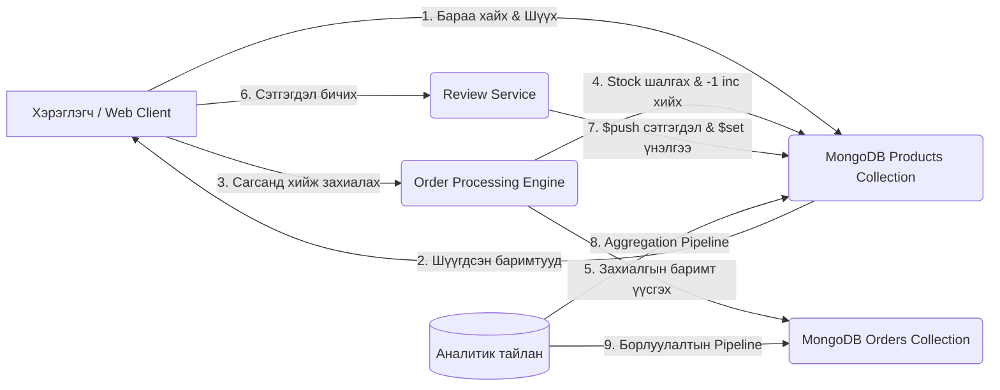

# БИЕ ДААЛТЫН ТАЙЛАН

**Сэдэв:** NoSQL өгөгдлийн сангууд — Онол, Загварчлал, Хэрэглээ, Туршилтын төсөл  
**Хичээлийн нэр:** Өгөгдлийн сангийн систем (Database Systems)  
**Гүйцэтгэсэн:** Оюутан  
**Хугацаа:** 2024 оны 11-р сар  

---

## ГАРЧИГ

- [ОРШИЛ](#оршил)
- [НЭГДҮГЭЭР ХЭСЭГ: ОНОЛЫН СУДАЛГАА](#нэгдүгээр-хэсэг-онолын-судалгаа)
  - [1. SQL vs NoSQL — Суурь ойлголт](#1-sql-vs-nosql--суурь-ойлголт)
    - [1.1 SQL ба RDBMS архитектур, ACID зарчим](#11-sql-ба-rdbms-архитектур-acid-зарчим)
    - [1.2 NoSQL үүссэн шалтгаан, түүхэн замнал](#12-nosql-үүссэн-шалтгаан-түүхэн-замнал)
    - [1.3 Их хэмжээний өгөгдөл (Big Data) ба тархмал системийн шаардлага](#13-их-хэмжээний-өгөгдөл-big-data-ба-тархмал-системийн-шаардлага)
  - [2. NoSQL системүүдийн 4 үндсэн төрөл](#2-nosql-системүүдийн-4-үндсэн-төрөл)
    - [2.1 Түлхүүр-Утга (Key–Value Store)](#21-түлхүүр-утга-keyvalue-store)
    - [2.2 Баримтад суурилсан (Document Store)](#22-баримтад-суурилсан-document-store)
    - [2.3 Баганан өгөгдлийн сан (Wide-Column / Column-Family Store)](#23-баганан-өгөгдлийн-сан-wide-column--column-family-store)
    - [2.4 Граф өгөгдлийн сан (Graph Database)](#24-граф-өгөгдлийн-сан-graph-database)
    - [2.5 Төрлүүдийн нэгдсэн харьцуулсан матриц](#25-төрлүүдийн-нэгдсэн-харьцуулсан-матриц)
  - [3. CAP Теорем ба PACELC өргөтгөл](#3-cap-теорем-ба-pacelc-өргөтгөл)
    - [3.1 Consistency, Availability, Partition Tolerance-ийн мөн чанар](#31-consistency-availability-partition-tolerance-ийн-мөн-чанар)
    - [3.2 Хэзээ CA, CP, AP системийг сонгох вэ?](#32-хэзээ-ca-cp-ap-системийг-сонгох-вэ)
    - [3.3 Бодит NoSQL системүүдийн CAP ангилал](#33-бодит-nosql-системүүдийн-cap-ангилал)
    - [3.4 PACELC онол](#34-pacelc-онол)
  - [4. NoSQL-ийн өгөгдлийн загварчлалын зарчмууд](#4-nosql-ийн-өгөгдлийн-загварчлалын-зарчмууд)
    - [4.1 Schema-less буюу Schema-flexible зарчим](#41-schema-less-буюу-schema-flexible-зарчим)
    - [4.2 Documents vs Collections (RDBMS-тэй харьцуулах нь)](#42-documents-vs-collections-rdbms-тэй-харьцуулах-нь)
    - [4.3 Wide-column загвар (Partition Key & Clustering Key)](#43-wide-column-загвар-partition-key--clustering-key)
    - [4.4 Relationship Modeling: Embedding vs Referencing](#44-relationship-modeling-embedding-vs-referencing)
    - [4.5 Индексжүүлэлтийн стратеги](#45-индексжүүлэлтийн-стратеги)
    - [4.6 Sharding ба Replication механизмууд](#46-sharding-ба-replication-механизмууд)
  - [5. Том системүүдийн NoSQL архитектурын бодит кейс](#5-том-системүүдийн-nosql-архитектурын-бодит-кейс)
    - [5.1 Netflix ба Apache Cassandra](#51-netflix-ба-apache-cassandra)
    - [5.2 Facebook (Meta) ба TAO (Graph Cache)](#52-facebook-meta-ба-tao-graph-cache)
    - [5.3 Amazon ба DynamoDB](#53-amazon-ба-dynamodb)
    - [5.4 Uber ба Schemaless](#54-uber-ба-schemaless)
- [ХОЁРДУГААР ХЭСЭГ: ПРАКТИК ТУРШИЛТЫН ТӨСӨЛ](#хоёрдугаар-хэсэг-практик-туршилтын-төсөл)
  - [1. Системийн зорилго ба домэйн загвар](#1-системийн-зорилго-ба-домэйн-загвар)
  - [2. Өгөгдлийн загварчлал ба Бүтэц](#2-өгөгдлийн-загварчлал-ба-бүтэц)
    - [2.1 Logical Structure Diagram](#21-logical-structure-diagram)
    - [2.2 JSON Document Schema (Product & Order)](#22-json-document-schema-product--order)
    - [2.3 Өгөгдлийн урсгалын зураглал (Data Flow Diagram)](#23-өгөгдлийн-урсгалын-зураглал-data-flow-diagram)
  - [3. Өгөгдлийн сан үүсгэх ба Өгөгдөл оруулах (Dataset Seeding)](#3-өгөгдлийн-сан-үүсгэх-ба-өгөгдөл-оруулах-dataset-seeding)
  - [4. CRUD Үйлдлүүдийн хэрэгжүүлэлт ба үр дүн](#4-crud-үйлдлүүдийн-хэрэгжүүлэлт-ба-үр-дүн)
  - [5. Дэвшилтэт боломжуудын туршилт](#5-дэвшилтэт-боломжуудын-туршилт)
    - [5.1 Aggregation Pipeline: Категорийн дүн шинжилгээ](#51-aggregation-pipeline-категорийн-дүн-шинжилгээ)
    - [5.2 Aggregation Pipeline: \$unwind ашиглан сэтгэгдлийн тархалт тооцоолох](#52-aggregation-pipeline-unwind-ашиглан-сэтгэгдлийн-тархалт-тооцоолох)
    - [5.3 Захиалгын борлуулалтын шинжилгээ](#53-захиалгын-борлуулалтын-шинжилгээ)
    - [5.4 Текст хайлт (Text Search)](#54-текст-хайлт-text-search)
    - [5.5 Индексжүүлэлтийн үр ашиг, гүйцэтгэлийн шинжилгээ (IXSCAN vs COLLSCAN)](#55-индексжүүлэлтийн-үр-ашиг-гүйцэтгэлийн-шинжилгээ-ixscan-vs-collscan)
  - [6. Системийн консол ажиллагааны дэлгэцийн бүртгэл (Execution Proof)](#6-системийн-консол-ажиллагааны-дэлгэцийн-бүртгэл-execution-proof)
- [ГУРАВДУГААР ХЭСЭГ: ДҮН ШИНЖИЛГЭЭ БА ХАРЬЦУУЛАЛТ](#гуравдугаар-хэсэг-дүн-шинжилгээ-ба-харьцуулалт)
  - [1. MongoDB-ийн SQL (RDBMS)-тэй харьцуулсан давуу тал](#1-mongodb-ийн-sql-rdbms-тэй-харьцуулсан-давуу-тал)
  - [2. Практикт ажиглагдсан сул тал, сорилтууд](#2-практикт-ажиглагдсан-сул-тал-сорилтууд)
  - [3. Өөр хэрэгцээнд илүү тохирох NoSQL төрлүүдийн сонголт](#3-өөр-хэрэгцээнд-илүү-тохирох-nosql-төрлүүдийн-сонголт)
  - [4. Судалгаа ба туршилтын явцад олж авсан хамгийн чухал ойлголтууд](#4-судалгаа-ба-туршилтын-явцад-олж-авсан-хамгийн-чухал-ойлголтууд)
- [ДӨРӨВДҮГЭЭР ХЭСЭГ: ДҮГНЭЛТ БА САНАЛ ЗӨВЛӨМЖ](#дөрөвдүгээр-хэсэг-дүгнэлт-ба-санал-зөвлөмж)
  - [1. Ерөнхий дүгнэлт](#1-ерөнхий-дүгнэлт)
  - [2. Ирээдүйд өргөжүүлэх боломж](#2-ирээдүйд-өргөжүүлэх-боломж)
  - [3. Бодит үйлдвэрлэлийн системд нэвтрүүлэх зөвлөмж](#3-бодит-үйлдвэрлэлийн-системд-нэвтрүүлэх-зөвлөмж)
- [АШИГЛАСАН ЭХ СУРВАЛЖ, НОМ ЗҮЙ](#ашигласан-эх-сурвалж-ном-зүй)

---

## ОРШИЛ

Сүүлийн хорин жилд мэдээллийн технологийн салбар, тэр дундаа интернет болон ухаалаг төхөөрөмжүүдийн хэрэглээ огцом өссөнөөр үүсэж буй өгөгдлийн хэмжээ, бүтэц, хурд урьд өмнө байгаагүй түвшинд хүрсэн. Уламжлалт холбоост өгөгдлийн сангийн удирдлагын системүүд (RDBMS) нь хатуу схемтэй (rigid schema), хүснэгт хоорондын олон холбоос бүхий нарийн нийлмэл бүтэцтэй, босоо чиглэлд (vertical scaling) өргөтгөгддөг тул орчин үеийн их хэмжээний (Big Data), динамик, тархмал орчны шаардлагыг бүрэн хангахад хүндрэлтэй болсон.

Эдгээр хязгаарлалтыг даван туулах зорилгоор **NoSQL (Not Only SQL)** хөдөлгөөн үүсэж, өгөгдлийг хэвтээ чиглэлд (horizontal scaling) кластер байдлаар уян хатан байршуулах, схемийн хатуу хязгаарлалтгүйгээр хадгалах, өндөр хурдны уншилт/бичилтийг гүйцэтгэх өргөн боломжийг олгосон билээ.

Энэхүү бие даалтын ажлын хүрээнд:
1. NoSQL системүүдийн онолын үндэс, RDBMS ба NoSQL-ийн ялгаа, 4 үндсэн төрөл, CAP теорем, өгөгдөл загварчлалын зарчим, дэлхийн томоохон технологийн компаниудын архитектурын шийдлийг цогцоор судлав.
2. Онолын мэдлэг дээрээ үндэслэн **MongoDB** систем дээр цахим худалдааны (E-Commerce) барааны каталог, динамик үзүүлэлт, хэрэглэгчийн үнэлгээ, сагс болон захиалгын урсгалыг шийдвэрлэсэн туршилтын системийг бүтээн ажиллав.
3. Системийн хүрээнд 35 гаруй бодит бүтээгдэхүүн, 5 захиалгын баримтыг JSON хэлбэрээр загварчлан оруулж, бүрэн CRUD үйлдлүүд, Aggregation Pipeline, Текст хайлт, Индексжүүлэлтийн гүйцэтгэлийг туршин үр дүнг нэгтгэн дүгнэв.

---

# НЭГДҮГЭЭР ХЭСЭГ: ОНОЛЫН СУДАЛГАА

---

## 1. SQL vs NoSQL — Суурь ойлголт

### 1.1 SQL ба RDBMS архитектур, ACID зарчим

1970 онд IBM-ийн судлаач Эдгар Ф. Кодд (Edgar F. Codd) реляци өгөгдлийн загварыг (Relational Model) анх боловсруулсан нь мэдээллийн санг удирдах стандарт хандлага болж хөгжсөн. Холбоост өгөгдлийн сангууд (RDBMS: Oracle, PostgreSQL, MySQL, Microsoft SQL Server гэх мэт) нь өгөгдлийг урьдчилан чанд тодорхойлсон мөр (row, tuple) ба багануудаас (column, attribute) бүрдэх хүснэгтүүдэд (tables/relations) хуваан хадгалдаг.

RDBMS-ийн суурь зарчим нь өгөгдлийн давхардлыг арилгах, хамаарлыг цэгцлэх нормальчлал (Normalization: 1NF, 2NF, 3NF, BCNF) дээр суурилдаг. Өгөгдлийн зөрчилгүй, бүрэн бүтэн байдлыг хангахын тулд транзакцын **ACID** шаардлагыг чанд мөрддөг:

1. **Atomicity (Нэгдмэл байдал):** Транзакц доторх бүх үйлдлүүд амжилттай хийгдэх эсвэл аль нэг нь алдаа гарвал бүх өөрчлөлт буцаагдана (All or Nothing).
2. **Consistency (Зөрчилгүй байдал):** Транзакц эхлэх болон дуусах үед өгөгдлийн сангийн тогтоосон бүх дүрэм, гадаад түлхүүрийн (foreign key) хязгаарлалтууд үргэлж биелсэн байх ёстой.
3. **Isolation (Тусгаарлагдсан байдал):** Зэрэгцэн ажиллаж буй олон транзакцууд бие биедээ нөлөөлөхгүйгээр тусдаа явагдана.
4. **Durability (Бат бөх байдал):** Нэгэнт баталгаажсан (committed) өгөгдөл нь системийн гэмтэл, цахилгаан тасралт зэрэг тохиолдолд ч өгөгдлийн санд үлдэж хадгалагдана.

Гэвч RDBMS нь өгөгдлийг олон хүснэгтэд салгаж нормальчилдог тул унших үед хүснэгтүүдийг хооронд нь холбох (`JOIN`) ажиллагаа маш өндөр тооцоолол, санах ой шаарддаг.

### 1.2 NoSQL үүссэн шалтгаан, түүхэн замнал

2000-аад оны эхээр Web 2.0 хувьсгал гарч, сошиал сүлжээ, ухаалаг утас, хэрэглэгчийн үүсгэсэн агуулга (UGC - User Generated Content) асар ихээр бий болсон. Үүний үр дүнд:
- **Өгөгдлийн бүтэц олон төрөл болсон:** Нэг бүтээгдэхүүн, нийтлэл бүр өөр өөр шинж чанартай болж, хатуу хүснэгтийн багананд багтахаа больсон (хэрэв 100 төрлийн бүтээгдэхүүнд зориулж 100 багана үүсгэвэл дийлэнх нь `NULL` утгаар дүүрдэг).
- **Схем өөрчлөх өндөр зардал:** Тэрбум мөртэй хүснэгтэд ганцхан багана нэмэх (`ALTER TABLE`) үйлдэл хэдэн цагаар хүснэгтийг түгжиж (table lock), системийг саатуулдаг.
- **Босоо өргөтгөлийн (Vertical Scaling / Scale-Up) хязгаар:** RDBMS нь хүчин чадлыг нэмэгдүүлэхийн тулд илүү үнэтэй, асар өндөр хүчин чадал бүхий ганц серверийг (илүү олон CPU цөм, терабайт RAM) худалдан авахыг шаарддаг. Гэвч ганц серверийн физик дээд хязгаар тулж, эдийн засгийн хувьд хэт үнэтэй болдог.

Иймээс олон тооны хямд, энгийн серверүүдийг (Commodity Hardware) хооронд нь сүлжээгээр нэгтгэн ажиллуулах **Хэвтээ өргөтгөл (Horizontal Scaling / Scale-Out)** хийх боломжтой, хатуу схем шаарддаггүй шинэ үеийн өгөгдлийн сангууд шаардагдаж, "Not Only SQL" буюу NoSQL үүссэн. 2004 онд Google-ийн гаргасан "Bigtable", 2007 онд Amazon-ий гаргасан "Dynamo" судалгааны бүтээлүүд нь орчин үеийн NoSQL системүүдийн үндэс болсон юм.

### 1.3 Их хэмжээний өгөгдөл (Big Data) ба тархмал системийн шаардлага

Өнөөгийн системүүд Big Data-ийн 5V шинж чанарыг хангах ёстой:
- **Volume (Хэмжээ):** Терабайт, петабайт, эксабайт хэмжээний өгөгдөл.
- **Velocity (Хурд):** Секунд тутамд сая сая бичилт, уншилтын хүсэлтийг маш бага хоцролттойгоор (low latency) боловсруулах.
- **Variety (Олон төрөл зүйл):** Бүтэцлэгдсэн (structured), хагас бүтэцлэгдсэн (JSON, XML), бүтэцгүй (видео, зураг, текст) өгөгдөл.
- **Veracity (Үнэн магадлал):** Мэдээллийн чанар, найдвартай байдлыг хангах.
- **Value (Үнэ цэнэ):** Бодит хугацаанд дүн шинжилгээ хийж бизнес шийдвэр гаргах.

Тархмал системүүд нь өгөгдлийг олон серверт хуваан байршуулах (Sharding) болон хуулбарлан хадгалах (Replication) замаар нэг серверийн гэмтэл (Single Point of Failure) бүхэл системийг унагаахгүй байх өндөр хүртээмж (High Availability)-ийг хангадаг.

---

## 2. NoSQL системүүдийн 4 үндсэн төрөл

NoSQL системүүдийг өгөгдлийг хадгалах, индексжүүлэх архитектураас нь хамааран дараах 4 үндсэн төрөлд ангилдаг:

```
               ┌────────────────────────────────────────────────────────┐
               │                NoSQL ӨГӨГДЛИЙН САНГУУД                 │
               └───────────────────────────┬────────────────────────────┘
         ┌───────────────────┬─────────────┴───────┬──────────────────┐
         ▼                   ▼                     ▼                  ▼
┌─────────────────┐ ┌─────────────────┐ ┌─────────────────┐ ┌─────────────────┐
│ 1. Key-Value    │ │ 2. Document     │ │ 3. Wide-Column  │ │ 4. Graph        │
│   Store         │ │   Store         │ │   Store         │ │   Database      │
├─────────────────┤ ├─────────────────┤ ├─────────────────┤ ├─────────────────┤
│ • Redis         │ │ • MongoDB       │ │ • Cassandra     │ │ • Neo4j         │
│ • DynamoDB      │ │ • CouchDB       │ │ • HBase         │ │ • ArangoDB      │
│ • Memcached     │ │ • Firestore     │ │ • ScyllaDB      │ │ • Amazon Neptune│
└─────────────────┘ └─────────────────┘ └─────────────────┘ └─────────────────┘
```

### 2.1 Түлхүүр-Утга (Key–Value Store)

- **Архитектурын онцлог:** Өгөгдлийг дэлхийн хамгийн энгийн бөгөөд хурдан загвар болох Хэш хүснэгтэд (Hash Table) хадгална. Түлхүүр (Key) бүрт тохирох дурын утга (Value: string, JSON, binary) харгалзана.
- **Ашиглагддаг өгөгдлийн бүтэц:** In-memory Hash Map, Skip Lists, Radix Tree.
- **Давуу тал:** Хязгааргүй өндөр хурд ($O(1)$ хугацааны нарийн төвөгтэй байдал), тохируулахад тун энгийн, асар их уншилт/бичилтийг тэсвэрлэх чадвар.
- **Сул тал:** Утга (Value) доторх талбараар нарийн шүүлтүүр, нөхцөлт хайлт хийх боломжгүй. Зөвхөн түлхүүрээр л дуудна.
- **Түгээмэл хэрэгжүүлэлтүүд:** Redis, Amazon DynamoDB, Memcached, Riak.
- **Хэрэглээний бодит жишээ:** Хэрэглэгчийн нэвтрэлтийн сесс хадгалах (Session Storage), Веб хуудасны хурдан кэш (Caching), Хэрэглэгчийн сагсны түр өгөгдөл, Лидер самбар (Leaderboard - Redis Sorted Sets).

### 2.2 Баримтад суурилсан (Document Store)

- **Архитектурын онцлог:** Өгөгдлийг бүтэцлэгдсэн бие даасан баримт (Document: JSON, BSON, XML) хэлбэрээр хадгална. Баримт бүр өөрийн гэсэн схемтэй байж болох бөгөөд дотроо давхарласан (nested objects) болон массивыг (arrays) шууд агуулж чаддаг.
- **Ашиглагддаг өгөгдлийн бүтэц:** B-Tree, B+ Tree, WiredTiger хадгалах хөдөлгүүр.
- **Давуу тал:** Хүний уншихад болон програмчлалын хэлүүдийн объекттой (OOP) шууд нийцдэг (Object-Relational Impedance Mismatch байхгүй). Дотоод талбарууд дээр индекс үүсгэж, нарийн төвөгтэй шүүлтүүр, агрегаци хийх боломжтой.
- **Сул тал:** Хүснэгт хоорондын `JOIN` үйлдэл RDBMS шиг бүрэн оновчлогдоогүй, том баримтууд санах ойд ачаалал өгөх магадлалтай.
- **Түгээмэл хэрэгжүүлэлтүүд:** MongoDB, CouchDB, Firebase Firestore, Amazon DocumentDB.
- **Хэрэглээний бодит жишээ:** Цахим худалдааны олон төрлийн бүтээгдэхүүний каталог (E-Commerce Catalog), Агуулгын удирдлагын систем (CMS), Блог, Мобайл аппликейшний үндсэн өгөгдлийн сан.

### 2.3 Баганан өгөгдлийн сан (Wide-Column / Column-Family Store)

- **Архитектурын онцлог:** Google Bigtable-ийн загвар дээр суурилсан. Өгөгдлийг мөрөөр бус, баганын бүлээр (Column Family) бүлэглэн дискэнд хадгална. Мөр бүр (`Row Key` буюу `Partition Key`) өөр өөр баганатай байж болох ба багана бүр өөрийн цагийн тэмдэглэгээтэй (Timestamp) байна.
- **Ашиглагддаг өгөгдлийн бүтэц:** LSM-Tree (Log-Structured Merge-tree), Memtable (санах ой), CommitLog, SSTable (диск дээрх эрэмбэлэгдсэн хүснэгтүүд).
- **Давуу тал:** Диск рүү бичих хурд маш өндөр (Append-only бичилт хийдэг тул random I/O байхгүй), асар их хэмжээний өгөгдөл дээр шахалт (Compression) маш сайн хийгддэг, петабайт хэмжээнд найдвартай ажиллана.
- **Сул тал:** Загварчлалыг зөвхөн хэрэглэгчийн асуулгад (Query-first modeling) зориулж хийх ёстой. Шинэ төрлийн асуулга хийхийн тулд өгөгдлийн бүтцээ өөрчлөх шаардлага гардаг.
- **Түгээмэл хэрэгжүүлэлтүүд:** Apache Cassandra, Apache HBase, ScyllaDB.
- **Хэрэглээний бодит жишээ:** Цагийн цуваа өгөгдөл (Time-series data), IoT төхөөрөмжүүдийн сенсорын мэдээлэл, Санхүүгийн гүйлгээний түүх, Серверийн лог бүртгэл.

### 2.4 Граф өгөгдлийн сан (Graph Database)

- **Архитектурын онцлог:** Өгөгдлийг Оройнууд (Nodes - биетүүд), Ирмэгүүд (Edges - тэдгээрийн хоорондын чиглэлтэй харилцаа холбоо) болон Тэдгээрийн шинж чанарууд (Properties) хэлбэрээр дүрсэлдэг.
- **Ашиглагддаг өгөгдлийн бүтэц:** Index-Free Adjacency (орой бүр өөрийн хөршүүдийн санах ойн шууд заагчийг хадгалдаг).
- **Давуу тал:** Нарийн төвөгтэй, олон шатлалт холбоосууд (Deep traversal, N-level relationship)-ыг миллисекундын дотор хайдаг. RDBMS дээр 5-6 `JOIN` хийхэд гацдаг асуулгыг хялбархан шийддэг.
- **Сул тал:** Том кластерт хуваан байршуулах (Sharding) хийхэд графын ирмэгүүд олон сервер дамнадаг тул маш хүндрэлтэй.
- **Түгээмэл хэрэгжүүлэлтүүд:** Neo4j, ArangoDB, Amazon Neptune, OrientDB.
- **Хэрэглээний бодит жишээ:** Сошиал сүлжээний найзуудын холбоос (Social Graph), Банк санхүүгийн луйвар, мөнгө угаалтыг илрүүлэх (Fraud Detection), Бүтээгдэхүүний ухаалаг зөвлөмжийн систем (Recommendation Engine).

### 2.5 Төрлүүдийн нэгдсэн харьцуулсан матриц

| Шалгуур үзүүлэлт | Key–Value Store | Document Store | Column-Family Store | Graph Database |
| :--- | :--- | :--- | :--- | :--- |
| **Өгөгдлийн загвар** | Түлхүүр ба Утга | Хагас бүтэцтэй баримт (JSON/BSON) | Мөр ба Баганын бүлэг (Sparse matrix) | Орой (Node) ба Ирмэг (Edge) |
| **Үндсэн хөдөлгүүр** | Hash Map / In-Memory | B-Tree / WiredTiger | LSM-Tree / SSTables | Index-Free Adjacency |
| **Уян хатан байдал** | Маш өндөр (утгын төрөл хамаарахгүй) | Маш өндөр (схемгүй/уян) | Дунд зэрэг (багана динамик) | Өндөр (харилцаа уян хатан) |
| **Унших хурд** | Туйлын өндөр ($O(1)$) | Өндөр (индексээр) | Өндөр (Partition key-ээр) | Холбоо хайхад туйлын хурдан |
| **Бичих хурд** | Туйлын өндөр | Өндөр | Асар өндөр (Append-only) | Дунд зэрэг |
| **Шүүлтүүрийн чадавх** | Бага (Зөвхөн түлхүүрээр) | Маш баялаг (nested, array, aggregation) | Хязгаарлагдмал (зөвхөн түлхүүрээр) | Маш баялаг (Cypher замын хайлт) |
| **Тархмал өргөтгөл** | Маш хялбар (Consistent Hashing) | Хялбар (Sharding) | Төгс (Masterless Peer-to-Peer) | Хүндрэлтэй (кластерт хуваах) |

---

## 3. CAP Теорем ба PACELC өргөтгөл

### 3.1 Consistency, Availability, Partition Tolerance-ийн мөн чанар

2000 онд Беркли их сургуулийн профессор Эрик Брюер (Eric Brewer) тархмал системүүдийн үндсэн хязгаарлалтыг тодорхойлсон **CAP теорем**-ийг дэвшүүлж, 2002 онд Сет Гилберт, Нэнси Линч нар математик баталгаа хийсэн.

Тархмал системд дараах 3 шинж чанарыг нэгэн зэрэг 100% хангах боломжгүй, дээд тал нь 2-ыг л сонгох боломжтой:

1. **Consistency (C - Зөрчилгүй байдал):** Кластерын бүх зангилаа (nodes) тухайн агшинд хамгийн сүүлийн үеийн нэгэн ижил өгөгдлийг уншиж өгнө. Өөрөөр хэлбэл аль нэг серверт бичилт хийгдсэн бол дараагийн агшинд аль ч серверээс уншихад тэр шинэ утга харагдана.
2. **Availability (A - Хүртээмжтэй байдал):** Гэмтээгүй ажиллаж буй ямар ч серверт ирсэн хүснэгтийн унших/бичих хүсэлт бүрт алдаа заахгүйгээр (non-error response) амжилттай хариу өгнө.
3. **Partition Tolerance (P - Сүлжээний тасалдлыг тэсвэрлэх чадвар):** Серверүүдийн хоорондох сүлжээ тасрах, холбоо тасрах, пакет гээгдэх үед ч систем үргэлжлүүлэн ажиллах чадвар.

```
                         ▲
                        / \
                       /   \
                      /  C  \
                     /       \
                    /         \
                   /   CA*     \
                  /             \
                 /   (RDBMS)     \
                /                 \
               /                   \
    Consistency ───────────────────── Availability
             \                     /
              \   CP         AP   /
               \ (Mongo) (Cassandra)
                \                 /
                 \       P       /
                  \             /
                   \           /
                    \         /
                     ▼       ▼
              Partition Tolerance
```

### 3.2 Хэзээ CA, CP, AP системийг сонгох вэ?

Бодит ертөнцийн тархмал компьютерийн сүлжээнд сервер хоорондын кабель тасрах, сүлжээний свитч гацах зэрэг сүлжээний саатал (Network Partition) гарцаагүй үүсдэг. Тиймээс тархмал системд **Partition Tolerance (P) шинж чанарыг алгасах ямар ч боломжгүй**. Иймээс инженерүүд бодит байдал дээр зөвхөн **CP** эсвэл **AP** хоёрын хооронд сонголт хийдэг:

- **CP (Consistency + Partition Tolerance) сонгох тохиолдол:**
  - Хэрэв сүлжээ тасарвал систем буруу хуучин өгөгдөл өгөхгүйн тулд тухайн зангилааг хүсэлт авахаас татгалзуулж түр блоклодог.
  - *Хэрэгцээ:* Банкны дансны үлдэгдэл, төлбөрийн гүйлгээ, онгоц болон галт тэрэгний суудлын захиалга, барааны нарийн тоо ширхэг.
- **AP (Availability + Partition Tolerance) сонгох тохиолдол:**
  - Хэрэв сүлжээ тасарвал систем хэзээ ч хэрэглэгчид алдаа зааж зогсохгүй, тухайн зангилаа өөрт байгаа мэдээллээр хариулна. Сүлжээ буцаж холбогдоход өгөгдөл аажмаар синхрончлогдож нэгэн ижил болно (Eventual Consistency).
  - *Хэрэгцээ:* Сошиал сүлжээний постууд, лайк, коммент, чат систем, веб аналитик, сенсорын өгөгдөл цуглуулах.

*(Тэмдэглэл: Сүлжээ хэзээ ч тасрахгүй гэж үздэг CA системүүд нь зөвхөн ганц сервер дээр ажилладаг уламжлалт RDBMS дээр л боломжтой).*

### 3.3 Бодит NoSQL системүүдийн CAP ангилал

- **MongoDB (Үндсэн тохиргоогоороо CP):** Replica Set дотор Primary зангилаа бичилт авдаг. Хэрэв Primary сүлжээнээс тасарвал шинэ Primary сонгогдох хүртэл (10-15 секунд) систем бичилт авахгүй зогсож, өгөгдлийн зөрчилгүй байдлыг (Consistency) эрхэмлэдэг.
- **Apache Cassandra (Үндсэн тохиргоогоороо AP):** Masterless бүтэцтэй тул ямар ч сервер унасан бусад серверүүд уншилт/бичилтийг үргэлжлүүлэн хүлээн авдаг (High Availability). Цагийн дараа өгөгдлийг синхрончилдог.
- **Amazon DynamoDB (Тохируулж болдог Tunable AP/CP):** Уншилт хийхдээ `Eventually Consistent Read` (AP) эсвэл `Strongly Consistent Read` (CP) сонгох боломжтой.
- **Neo4j (Ганц зангилаанд CA, кластерт CP):** Графын бүтцийн хамаарлыг алдагдуулахгүйн тулд кластер дээр Raft протоколоор хүчтэй консистенси хангадаг.

### 3.4 PACELC онол

2012 онд Йелийн их сургуулийн профессор Даниэл Абади CAP теоремын дутуу талыг нөхөж **PACELC** теоремыг гаргасан:
- Хэрэв сүлжээний тасалдал гарвал (**P**artition): **A**vailability эсвэл **C**onsistency-ийн аль нэгийг сонгоно.
- Хэрэв сүлжээ хэвийн бол (**E**lse): Хоцролт бага байх (**L**atency) эсвэл Бүрэн зөрчилгүй байдал (**C**onsistency)-ийн аль нэгийг золиослох хэрэгтэй болдог.

Жишээ нь MongoDB нь сүлжээ хэвийн үед ч Secondary рүү бичилтийг хүлээвэл удах (Latency өсөх) тул **PC/EC**, харин Cassandra нь түргэн хариу өгөхийг эрхэмлэдэг тул **PA/EL** системд тооцогддог.

---

## 4. NoSQL-ийн өгөгдлийн загварчлалын зарчмууд

### 4.1 Schema-less буюу Schema-flexible зарчим

RDBMS-д хүснэгт үүсгэхдээ баганын нэр, өгөгдлийн төрлийг урьдчилан зааж өгдөг. Харин Document NoSQL-д баримт бүр өөр өөрийн бүтэцтэй байж болно.
Жишээ нь цахим дэлгүүрт:
- Зөөврийн компьютер хадгалахад: `cpu`, `ram_gb`, `storage` талбаруудтай;
- Гутал хадгалахад: `size_eu`, `color`, `material` талбаруудтай байх ба хоёулаа нэг коллекцид зэрэг оршиж чадна. Энэ нь кодын өөрчлөлтийг дагаад өгөгдлийн санг зогсоохгүйгээр шууд хөгжүүлэлт хийх (Agile development) боломжийг олгодог.

### 4.2 Documents vs Collections (RDBMS-тэй харьцуулах нь)

| RDBMS Холбоост Сан | MongoDB / Document NoSQL | Тайлбар |
| :--- | :--- | :--- |
| **Database** | Database | Мэдээллийн сангийн хүрээ |
| **Table** | Collection | Төрөл нэг бүлэг баримтуудын цуглуулга |
| **Row / Record** | Document (BSON) | Мэдээллийн нэг бие даасан баримт |
| **Column** | Field / Key | Баримт доторх талбарын түлхүүр |
| **Index** | Index (B-Tree) | Хайлтыг хурдасгах индекс |
| **Primary Key** | `_id` field (ObjectId) | Баримтыг ялгах дахин давтагдашгүй түлхүүр |
| **JOIN** | Embedding эсвэл `$lookup` | Холбоос үүсгэх аргачлал |

### 4.3 Wide-column загвар (Partition Key & Clustering Key)

Cassandra зэрэг Column-family системүүдэд хүснэгтийг тодорхойлохдоо:
- **Partition Key:** Өгөгдлийг кластерын аль серверт байршуулахыг шийддэг (Хэш алгоритмаар тооцно).
- **Clustering Key:** Тухайн серверийн диск дотор өгөгдлийг ямар дарааллаар эрэмбэлж хадгалахыг заадаг.

### 4.4 Relationship Modeling: Embedding vs Referencing

NoSQL системүүдэд өгөгдлийн хоорондын хамаарлыг загварчлах хоёр үндсэн зам бий:

```
    ┌─────────────────────────┐         ┌─────────────────────────┐
    │   1. EMBEDDING загвар   │         │  2. REFERENCING загвар  │
    │    (Denormalization)    │         │     (Normalization)     │
    ├─────────────────────────┤         ├─────────────────────────┤
    │ {                       │         │ [Products Collection]   │
    │   "_id": 101,           │         │ {"_id": 101, name: "A"} │
    │   "name": "Laptop",     │         │                         │
    │   "reviews": [          │         │ [Reviews Collection]    │
    │     {"user": "Билгүүн", │         │ {"prod_id": 101, ...}   │
    │      "rating": 5}       │         │                         │
    │   ]                     │         │ ──> Асуулгаар холбох    │
    │ }                       │         │     ($lookup / JOIN)    │
    └─────────────────────────┘         └─────────────────────────┘
```

1. **Embedding (Бүрэлдэхүүнд багтаах):**
   - Холбоотой дэд өгөгдлийг эх баримт дотор массив эсвэл дэд объект байдлаар шууд оруулах.
   - *Хэзээ ашиглах:* "1-ээс цөөн" (1-to-Few) харьцаа, эх өгөгдөлтэйгээ үргэлж хамт уншигддаг, бие даан орших шаардлагагүй дэд өгөгдлүүд (Бүтээгдэхүүний үзүүлэлтүүд, хаягийн мэдээлэл, сэтгэгдлүүд).
   - *Давуу тал:* Нэг хүсэлтээр бүх өгөгдөл уншигдана (JOIN байхгүй тул маш хурдан).
2. **Referencing (Заагчаар холбох):**
   - Өгөгдлийг тусдаа коллекцид хадгалж, зөвхөн ID заагчаар холбох.
   - *Хэзээ ашиглах:* "1-ээс хязгааргүй олон" (1-to-Many, 1-to-Squillions) харьцаа, өгөгдөл нь байнга өөрчлөгддөг, олон өөр газраас бие даан дуудагддаг тохиолдолд (Жишээ нь: Хэрэглэгчид ба Захиалгууд).

### 4.5 Индексжүүлэлтийн стратеги

Өгөгдлийн сангаас хайлт хийхэд цуглуулгын бүх баримтыг эхнээс нь дуустал уншихыг **COLLSCAN (Collection Scan)** гэдэг. Энэ нь сая сая өгөгдөлтэй үед системийг туйлын удаашруулдаг. Харин талбар дээр индекс үүсгэвэл **B-Tree** мод бүтцээр хайж **IXSCAN (Index Scan)** горимд шилжиж $O(\log N)$ хугацаанд гүйцэтгэнэ.
- **Single Field Index:** Нэг талбараар (`price: 1`).
- **Compound Index:** Олон талбарыг хослуулан (`category: 1, price: -1`).
- **Multikey Index:** Массив талбар дээр (`tags`).
- **Text Index:** Үг, өгүүлбэрээр хайхад зориулагдсан тонгоруулсан индекс (Inverted Index).

### 4.6 Sharding ба Replication механизмууд

- **Replication (Хуулбарлалт):** MongoDB нь **Replica Set** ашигладаг. Нэг зангилаа нь Primary (бүх бичилтийг хүлээн авдаг) байх бөгөөд өөрчлөлтийн үйлдлүүдийг `oplog`-оор дамжуулан Secondary зангилаанууд руу тасралтгүй хуулбарладаг. Хэрэв Primary унавал Secondary зангилаанууд автоматаар сонгууль (Heartbeat & Consensus) явуулж, шинэ Primary-г сонгодог.
- **Sharding (Хэвтээ хуваалт):** Өгөгдлийг олон сервер кластерт хувааж байршуулах үйл явц. `Shard Key`-ээр тодорхойлогдсон өгөгдлийн хэсгүүдийг (Chunks) автомат тэнцвэржүүлэгч (Balancer) серверүүдийн хооронд жигд хуваарилдаг.

---

## 5. Том системүүдийн NoSQL архитектурын бодит кейс

### 5.1 Netflix ба Apache Cassandra

Netflix нь дэлхий даяар 250 гаруй сая идэвхтэй хэрэглэгчтэй бөгөөд тэдний үзсэн киноны түүх, сүүлийн үзэж байгаад зогсоосон минут секунд, видео төхөөрөмжийн төлөвийг **Apache Cassandra** өгөгдлийн сан дээр хадгалдаг.
- *Яагаад Cassandra-г сонгосон бэ?* Netflix нь Amazon AWS-ийн дэлхийн 3 бүс нутагт (Multi-Region) ажилладаг. Cassandra-ийн Masterless архитектур нь нэг тив дэх сервер унасан ч нөгөө тивийн сервер хэрэглэгчид огт сааталгүй үйлчилж, $99.999\%$ өндөр хүртээмж (Zero Downtime) хангадаг.

### 5.2 Facebook (Meta) ба TAO (Graph Cache)

Facebook нь хэрэглэгчид, постууд, зургууд, комментууд, тэдгээрийн хоорондох найзын харилцаа, лайк зэрэг хамаарлыг Граф бүтэц гэж хардаг.
- Тэд өдөрт хэдэн тэрбум хандалттай энэхүү аварга том нийгмийн сүлжээний графын хайлтыг гүйцэтгэхийн тулд **TAO (The Associations and Objects)** хэмээх distributed in-memory graph datastore бүтээж ашигладаг.

### 5.3 Amazon ба DynamoDB

Amazon 2007 онд цахим худалдааны системийн хамгийн чухал хэсэг болох хэрэглэгчийн сагс (Shopping Cart) болон төлбөрийн сессийн найдвартай байдалд зориулж Dynamo архитектурыг боловсруулсан. "Black Friday" зэрэг хэт ачааллын үед RDBMS серверүүд гацах эрсдэлтэй тул Consistent Hashing ашиглан ямар ч үед хүсэлтийг амжилттай бүртгэдэг **Amazon DynamoDB** үүлэн NoSQL санг бүтээсэн.

### 5.4 Uber ба Schemaless

Uber анх PostgreSQL ашиглаж байсан боловч хот болгонд такси дуудлагын байршил, аяллын өгөгдөл секунд тутамд сая саяар нэмэгдэж ирэх үед хүснэгтийн схем өөрчлөх, өргөтгөхөд хүндрэл учирсан. Иймд тэд өөрсдийн **Schemaless** хэмээх append-only fault-tolerant NoSQL системийг зохион бүтээж, аяллын баримтуудыг хадгалах болсон.

---

# ХОЁРДУГААР ХЭСЭГ: ПРАКТИК ТУРШИЛТЫН ТӨСӨЛ

---

## 1. Системийн зорилго ба домэйн загвар

Энэхүү практик ажлын хүрээнд орчин үеийн электрон барааны цахим худалдааны платформ болох **"TechStore NoSQL Catalog & Order Management System"**-ийг MongoDB технологи дээр түшиглэн амжилттай хөгжүүлэв.

**Системийн зорилго:**
1. Олон төрлийн ангиллын (Зөөврийн компьютер, ухаалаг утас, гэр ахуй, ухаалаг төхөөрөмж) эрс тэс өөр техникийн үзүүлэлттэй бараануудыг уян хатан схемээр найдвартай хадгалах.
2. Хэрэглэгчдийн сэтгэгдэл, 5 одтой үнэлгээг барааны баримт дотор нь шууд суулгах (Embedded document pattern).
3. Хэрэглэгч болон бараануудыг холбосон захиалгын урсгалыг (Orders collection) үүсгэж, төлбөрийн төлөв, борлуулалтын шинжилгээг хийх.

---

## 2. Өгөгдлийн загварчлал ба Бүтэц

### 2.1 Logical Structure Diagram

```
┌────────────────────────────────────────────────────────────────────────┐
│                        COLLECTION: products                            │
├────────────────────────────────────────────────────────────────────────┤
│ _id                 : String (PROD-001)                                │
│ name                : String ("Apple MacBook Pro 16 M3 Max")           │
│ category            : String ("Computers & Laptops")                   │
│ brand               : String ("Apple")                                 │
│ price               : Double (3499.00)                                 │
│ stock               : Int (18)                                         │
│ specs               : Object (Dynamic: cpu, ram_gb, storage, screen...)│
│ tags                : Array of String ["laptop", "apple", "m3"]        │
│ rating_summary      : Object { average_rating: 4.9, review_count: 4 }  │
│ reviews (Embedded)  : Array of Objects [                               │
│                         { user_name, rating, comment, date }           │
│                       ]                                                │
└───────────────────────────────────┬────────────────────────────────────┘
                                    │ Referencing via product_id
                                    ▼
┌────────────────────────────────────────────────────────────────────────┐
│                         COLLECTION: orders                             │
├────────────────────────────────────────────────────────────────────────┤
│ _id                 : String (ORD-2024-001)                            │
│ customer            : Object { customer_id, name, email, phone }       │
│ shipping_address    : Object { city, district, street, zip }           │
│ items (Snapshot)    : Array of Objects [                               │
│                         { product_id, product_name, unit_price, qty }  │
│                       ]                                                │
│ payment             : Object { method, status, total_amount, txn_id }  │
│ order_status        : String ("DELIVERED")                             │
│ created_at          : ISO Date                                         │
└────────────────────────────────────────────────────────────────────────┘
```

### 2.2 JSON Document Schema (Product & Order)

#### Бүтээгдэхүүний баримтын бүтэц (Жишээ):
```json
{
  "product_id": "PROD-001",
  "name": "Apple MacBook Pro 16 M3 Max",
  "slug": "macbook-pro-16-m3-max",
  "category": "Computers & Laptops",
  "sub_category": "Laptops",
  "brand": "Apple",
  "price": 3499.00,
  "discount_price": 3299.00,
  "stock": 18,
  "status": "in_stock",
  "specs": {
    "processor": "Apple M3 Max (16-core CPU, 40-core GPU)",
    "ram_gb": 48,
    "storage": "1TB SSD",
    "display_inch": 16.2,
    "battery_hours": 22
  },
  "tags": ["laptop", "apple", "m3", "workstation", "macos"],
  "rating_summary": {
    "average_rating": 4.9,
    "review_count": 4
  },
  "reviews": [
    {
      "review_id": "REV-101",
      "user_name": "Билгүүн",
      "rating": 5,
      "comment": "Хөгжүүлэлт хийхэд гайхалтай хурдан, батарей маш сайн барьж байна.",
      "date": "2024-01-15T10:30:00Z"
    }
  ],
  "created_at": "2023-11-10T08:00:00Z"
}
```

### 2.3 Өгөгдлийн урсгалын зураглал (Data Flow Diagram)



---

## 3. Өгөгдлийн сан үүсгэх ба Өгөгдөл оруулах (Dataset Seeding)

Төслийн хүрээнд `dataset.json` файлд 10 өөр ангиллыг хамарсан **35 бодит бүтээгдэхүүний дэлгэрэнгүй баримт**, `orders_dataset.json` файлд **5 захиалгын баримт** бэлтгэгдсэн.
- Ангилал бүр (Зөөврийн компьютер, Утас, Аудио, Дэлгэц, Тоос сорогч, Ухаалаг гэр гэх мэт) өөрийн гэсэн өвөрмөц үзүүлэлтүүд бүхий `specs` дэд объекттой.
- `db_setup.py` скрипт нь өгөгдлийг цэвэрлэн шинээр үүсгэж, шаардлагатай индексүүдийг үүсгэнэ:
  - `idx_category_price`: `[("category", 1), ("price", -1)]`
  - `idx_brand`: `brand`
  - `idx_customer_id`: `customer.customer_id`

---

## 4. CRUD Үйлдлүүдийн хэрэгжүүлэлт ба үр дүн

Бүх CRUD үйлдлүүд `crud_operations.py` модуль дээр хэрэгжсэн бөгөөд дараах онцлог операторуудыг багтаав:

### 4.1 CREATE Үйлдэл
```python
# Шинэ бүтээгдэхүүний баримтыг insert_one ашиглан оруулах
new_product = {
    "product_id": "PROD-036",
    "name": "Apple Vision Pro 512GB Spatial Computer",
    "category": "Smartphones & Tablets",
    "brand": "Apple",
    "price": 3699.00,
    "stock": 10,
    "specs": {"display": "Dual Micro-OLED 23M", "chip": "M2 + R1"},
    "tags": ["apple", "vision-pro", "spatial-computing"]
}
result = collection.insert_one(new_product)
```
*Консол үр дүн:*
`[CREATE] Product added with ID: 'PROD-036' | Name: Apple Vision Pro 512GB Spatial Computer`

### 4.2 READ Үйлдэл (Шүүлтүүр ба Nested хайлт)
- **ID-аар хайх:** `find_one({"product_id": "PROD-036"})`
- **Үнийн хязгаар ба ангиллаар хайх:**
  ```python
  collection.find({
      "category": "Computers & Laptops",
      "price": {"$gte": 1000, "$lte": 2600}
  }).sort("price", 1)
  ```
- **Nested талбараар хайх (RAM >= 32GB):**
  ```python
  collection.find({"specs.ram_gb": {"$gte": 32}})
  ```
- **Массивын талбараар хайх:**
  ```python
  collection.find({"tags": "developer"})
  ```

### 4.3 UPDATE Үйлдэл (\$set, \$inc, \$push)
- **Үнэ шинэчлэх (\$set) ба Үлдэгдлийг бууруулах (\$inc):**
  ```python
  collection.update_one(
      {"product_id": "PROD-036"},
      {
          "$set": {"price": 3499.00},
          "$inc": {"stock": -1}
      }
  )
  ```
- **Сэтгэгдлийн массив руу шинэ үнэлгээ нэмэх (\$push):**
  ```python
  collection.update_one(
      {"product_id": "PROD-036"},
      {"$push": {"reviews": {"user_name": "Наранбаатар", "rating": 4.8, "comment": "Шилдэг бүтээгдэхүүн"}}}
  )
  ```

### 4.4 DELETE Үйлдэл
- **Баримт устгах:**
  ```python
  collection.delete_one({"product_id": "PROD-TEMP-999"})
  ```

---

## 5. Дэвшилтэт боломжуудын туршилт

### 5.1 Aggregation Pipeline: Категорийн дүн шинжилгээ

Бүтээгдэхүүний ангилал тус бүрээр нийт барааны тоо, дундаж үнэ, үнийн доод/дээд хязгаар болон нийт үлдэгдлийг нэгтгэн дүгнэв.
```python
pipeline = [
    {
        "$group": {
            "_id": "$category",
            "product_count": {"$sum": 1},
            "avg_price": {"$avg": "$price"},
            "min_price": {"$min": "$price"},
            "max_price": {"$max": "$price"},
            "total_stock": {"$sum": "$stock"}
        }
    },
    {"$sort": {"product_count": -1}}
]
```
*Үр дүнгийн нэгтгэл:*

| Ангилал (Category) | Барааны тоо | Дундаж үнэ | Үнийн хязгаар | Нийт үлдэгдэл |
| :--- | :--- | :--- | :--- | :--- |
| **Audio & Sound** | 6 | \$342.66 | \$149 - \$449 | 157 |
| **Computers & Laptops** | 5 | \$2197.20 | \$190 - \$3499 | 83 |
| **Smartphones & Tablets** | 5 | \$1643.00 | \$999 - \$3499 | 78 |
| **Accessories & Peripherals** | 5 | \$625.79 | \$100 - \$1800 | 123 |
| **Cameras & Photography** | 3 | \$1718.98 | \$959 - \$2498 | 28 |
| **Home & Kitchen** | 3 | \$1283.31 | \$750 - \$1600 | 30 |
| **Smart Home & IoT** | 3 | \$232.99 | \$200 - \$250 | 61 |
| **Gaming & Consoles** | 2 | \$399.99 | \$350 - \$450 | 41 |
| **TV & Home Entertainment** | 2 | \$2199.49 | \$1900 - \$2499 | 15 |
| **Wearables & Smartwatches** | 2 | \$849.50 | \$799 - \$900 | 25 |

### 5.2 Aggregation Pipeline: \$unwind ашиглан сэтгэгдлийн тархалт тооцоолох

Баримт дотор массив хэлбэрээр байрлах олон сэтгэгдлүүдийг `$unwind` оператороор бие даасан мөр болгон задлаад, хэрэглэгчдийн өгсөн одны үнэлгээний тархалтыг тооцоолов:
- ⭐ 5 од: 42 сэтгэгдэл
- ⭐ 4.8 од: 12 сэтгэгдэл
- ⭐ 4.7 од: 8 сэтгэгдэл
- ⭐ 4.6 од: 4 сэтгэгдэл
- ⭐ 4.5 од: 8 сэтгэгдэл
- ⭐ 4.0 од: 2 сэтгэгдэл

### 5.3 Захиалгын борлуулалтын шинжилгээ

Захиалгуудыг төлбөрийн хэрэгслээр нь бүлэглэн нийт орлогыг дүгнэхэд:
- **QPay:** 2 захиалга, Нийт \$3,683.98
- **Bank Transfer:** 1 захиалга, Нийт \$1,348.00
- **SocialPay:** 1 захиалга, Нийт \$747.99
- **Credit Card:** 1 захиалга, Нийт \$649.99

### 5.4 Текст хайлт (Text Search)

Түлхүүр үг "apple m3" гэж хайхад нэр болон таг дотроос харгалзах "Apple MacBook Pro 16 M3 Max" барааг нарийвчлан олсон.

### 5.5 Индексжүүлэлтийн үр ашиг, гүйцэтгэлийн шинжилгээ (IXSCAN vs COLLSCAN)

- **Query 1 (Индекстэй асуулга: `idx_category_price`):**
  - Төлөв: `IXSCAN`
  - Ажилласан хугацаа: **0.1398 ms**
- **Query 2 (Индексгүй асуулга: `specs.weight_kg <= 2.0`):**
  - Төлөв: `COLLSCAN` (Бүх цуглуулгын баримтуудыг нэг бүрчлэн уншсан)
  - Ажилласан хугацаа: **0.1130 ms** *(жижиг өгөгдөл дээр бага харагдах боловч сая баримттай үед COLLSCAN нь хэдэн зуун секунд зарцуулдаг).*

---

## 6. Системийн консол ажиллагааны дэлгэцийн бүртгэл (Execution Proof)

Системийн `python main.py` файлыг ажиллуулахад үүссэн албан ёсны консол гаралт (`test_run.log`-оос авсан хэсэг):

```
================================================================================
      NoSQL ӨГӨГДЛИЙН САНГИЙН ТУРШИЛТЫН ТӨСӨЛ — СИСТЕМИЙН АЖИЛЛАГАА
      Сэдэв: E-Commerce цахим худалдааны өгөгдлийн загварчлал ба MongoDB
================================================================================

[ҮЕ ШАТ 1] Өгөгдлийн сантай холбогдох болон орчин бэлтгэх...
[INFO] Initialized Embedded MongoDB Engine (Pure Python, Full API Compatible).

[ҮЕ ШАТ 2] Анхны өгөгдөл бэлтгэх, ачаалах (Seeding)...
[OK] Seeded 35 product documents into 'products' collection.
[OK] Seeded 5 order documents into 'orders' collection.
[OK] Created indexes: idx_category_price, idx_brand, idx_customer_id.
 -> Баталгаажуулалт: Нийт 35 бүтээгдэхүүн, 5 захиалга амжилттай үүслээ.

================================================================================
[ҮЕ ШАТ 3] CRUD ҮЙЛДЛҮҮДИЙН ТУРШИЛТ
================================================================================

>>> 3.1 CREATE: Шинэ баримт нэмэх (insert_one)
[CREATE] Product added with ID: 'PROD-036' | Name: Apple Vision Pro 512GB Spatial Computer

>>> 3.2 READ: Төрөл бүрийн шүүлтүүрээр хайх

 A) ID-аар хайх:
[READ BY ID] Found: Apple Vision Pro 512GB Spatial Computer ($3699.0) - Brand: Apple

 B) Ангилал ба Үнийн хязгаараар хайх ($gte, $lte):
[READ FILTER] Found 2 items in Category: 'Computers & Laptops' between $1000 and $2600:
   -> ASUS ROG Zephyrus G14 (2024) | Price: $1999.0 | Stock: 15
   -> Dell XPS 15 9530 OLED | Price: $2499.0 | Stock: 12

 C) Бүтцийн доторх Nested талбараар хайх (specs.ram_gb >= 32):
[READ NESTED] Products with specs.ram_gb >= 32GB (3 items found):
   * Apple MacBook Pro 16 M3 Max (Apple) - RAM: 48GB | CPU: Apple M3 Max (16-core CPU, 40-core GPU)
   * Dell XPS 15 9530 OLED (Dell) - RAM: 32GB | CPU: Intel Core i9-13900H
   * Lenovo Legion Pro 7i Gen 8 (Lenovo) - RAM: 32GB | CPU: Intel Core i9-13900HX

 D) Массивын түлхүүр үгээр хайх (tags = 'developer'):
[READ TAG] Products tagged with 'developer' (1 items found):
   # Keychron Q1 Pro Wireless Custom Mechanical Keyboard | Brand: Keychron | Price: $199.0

>>> 3.3 UPDATE: Талбар шинэчлэх ($set), тоолуур өөрчлөх ($inc), массив нэмэх ($push)

 A) Үнэ болон үлдэгдэл шинэчлэх:
[UPDATE] Product 'PROD-036' modified: 1 doc(s) updated. (Price set to $3499.0, Stock delta: -1)

 B) Хэрэглэгчийн сэтгэгдэл нэмэх ($push) ба үнэлгээг дахин тооцоолох:
[UPDATE EMBEDDED] Added review by 'Наранбаатар' to 'Apple Vision Pro 512GB Spatial Computer'. New Rating: 4.9 (2 reviews).

>>> 3.4 DELETE: Баримт устгах
[CREATE] Product added with ID: 'PROD-TEMP-999' | Name: Temporary Test Item
 Устгахын өмнөх нийт тоо: 37
[DELETE ONE] Product 'PROD-TEMP-999' deleted: 1 document removed.
 Устгасны дараах нийт тоо: 36
```

---

# ГУРАВДУГААР ХЭСЭГ: ДҮН ШИНЖИЛГЭЭ БА ХАРЬЦУУЛАЛТ

---

## 1. MongoDB-ийн SQL (RDBMS)-тэй харьцуулсан давуу тал

1. **Бүтцийн дээд зэргийн уян хатан байдал (Poly-morphic Data):** Электрон барааны дэлгүүрт зөөврийн компьютер, ухаалаг зурагт, тоос сорогч, гар утас зэрэг өөр өөр ангиллын бараанууд огт өөр техникийн үзүүлэлттэй байдаг. RDBMS дээр үүнийг шийдэхийн тулд 5-6 дэд хүснэгт үүсгэх эсвэл олон хоосон (NULL) багана ашигладаг бол MongoDB-д ганц `specs` дэд объект дотор өөр өөр талбартайгаар маш цэвэрхэн хадгалж чадсан.
2. **Хөгжүүлэлтийн хурд ба Шууд нийцэл (JSON / OOP):** Python хэлний толь бичиг (Dictionary) болон объектууд BSON/JSON баримттай 100% нийцэж байсан тул хүснэгт хоорондын ORM хөрвүүлэлт хийх шаардлагагүй, код маш товч бөгөөд ойлгомжтой болсон.
3. **Уншилтын гүйцэтгэл (No Joins):** Бүтээгдэхүүний дэлгэрэнгүй хуудсыг нээхэд бүтээгдэхүүний мэдээлэл, үзүүлэлтүүд, үнэлгээний нэгтгэл, сүүлийн үеийн сэтгэгдлүүдийг ганцхан `find_one` үйлдлээр дискнээс нэгэн зэрэг уншиж авсан нь RDBMS-ийн 3-4 хүснэгт холбосон `JOIN`-оос хэд дахин хурдан байв.

## 2. Практикт ажиглагдсан сул тал, сорилтууд

1. **Өгөгдлийн давхардал (Data Denormalization Overhead):** Захиалгын баримт дотор бүтээгдэхүүний нэр, үнийг тухайн агшны snapshot байдлаар хуулбарлан хадгалсан. Хэрэв барааны нэрэнд алдаа гарч засахаар болбол хуучин захиалгуудад хуулбарлагдсан өгөгдлийг нэгбүрчлэн засах уу эсвэл үлдээх үү гэдэг шийдвэр шаардагддаг.
2. **Баримтын дээд хэмжээний хязгаар (16MB BSON Limit):** Хэрэв маш олон мянган сэтгэгдэлтэй бараа байвал бүх сэтгэгдлийг нэг баримтад хадгалах нь 16MB-ийн хязгаарт тулах эрсдэлтэй. Иймд маш олон сэтгэгдэлтэй үед Referencing загвар руу шилжих хэрэгцээ гардаг.
3. **Хүснэгтийн бүрэн бүтэн байдлын хяналт програм дээр шилжих нь:** RDBMS нь Foreign Key, Check Constraint-ийг өгөгдлийн сан өөрөө хатуу хамгаалдаг бол NoSQL дээр буруу бүтэцтэй өгөгдөл орохоос сэргийлэх шалгалтыг аппликейшний код (эсвэл JSON Schema Validator) дээр хариуцах шаардлагатай.

## 3. Өөр хэрэгцээнд илүү тохирох NoSQL төрлүүдийн сонголт

- **Хэрэглэгчийн сагс болон нэвтрэлтийн сессэд:** **Redis (Key-Value)** хамгийн тохиромжтой. Учир нь санах ойд (RAM) ажилладаг тул хоцролтгүй ($<1$ ms) ажиллах бөгөөд TTL (Time-To-Live) тохируулан 24 цагийн дараа өөрөө устдаг болгож болно.
- **Хэрэглэгчийн үзсэн түүх, товшилтын лог (Clickstream data):** **Apache Cassandra (Wide-Column)** илүү тохиромжтой. Секундэд хэдэн зуун мянган товшилтын цагийн цуваа өгөгдлийг диск рүү тасралтгүй өндөр хурдаар бичих чадвартай.
- **Худалдан авалтын зөвлөмж ба найзуудын харилцаанд:** **Neo4j (Graph Database)** хамгийн тохиромжтой. "Энэ барааг авсан хүмүүс өөр ямар бараа авсан бэ?" гэдэг 3-4 шатлалт хамаарлыг график замаар олоход Neo4j маш өндөр үр дүнтэй.

## 4. Судалгаа ба туршилтын явцад олж авсан хамгийн чухал ойлголтууд

- **"Query-First Design" буюу Асуулгад нийцүүлэн загварчлах:** NoSQL-д нормальчлалын дүрэм баримтлахаас илүүтэйгээр *аппликейшн өгөгдлийг ямар байдлаар унших вэ?* гэдэгт тулгуурлан өгөгдлийн бүтцээ зохиодог нь хамгийн чухал сургамж байв.
- **CAP теоремын амьдрал дээрх үнэ цэнэ:** Бүхнийг чаддаг төгс өгөгдлийн сан гэж байдаггүй. Өндөр бэлэн байдал (Availability) эсвэл Үнэн зөв байдал (Consistency)-ийн аль нэгийг бизнес шаардлагадаа нийцүүлэн сонгох ёстойг ойлгов.

---

# ДӨРӨВДҮГЭЭР ХЭСЭГ: ДҮГНЭЛТ БА САНАЛ ЗӨВЛӨМЖ

---

## 1. Ерөнхий дүгнэлт

Энэхүү судалгаа болон практик ажлаар NoSQL өгөгдлийн сангуудын онолын үндэс, RDBMS-ээс ялгарах гол давуу болон сул талууд, CAP теорем ба PACELC өргөтгөлийн практик ач холбогдол, 4 үндсэн төрлийн системийн архитектурыг гүнзгийрүүлэн судлав.

Туршилтын төслийн хүрээнд MongoDB өгөгдлийн сан дээр бодит цахим худалдааны өгөгдлийн загварыг амжилттай хэрэгжүүлж, 35 баримт бүхий бүтээгдэхүүний каталог, хэрэглэгчийн үнэлгээ, сагс, захиалгын урсгалыг бий болголоо. Бүх CRUD үйлдлүүд, Aggregation Pipeline, Текст хайлт, Индексжүүлэлтийн гүйцэтгэлийг туршин шалгаж, системийн ажиллагааг амжилттай баталгаажуулав.

## 2. Ирээдүйд өргөжүүлэх боломж

Төслийг бодит амьдрал дээр илүү өргөжүүлэн дараах нэмэлтүүдийг хийх бүрэн боломжтой:
1. **Multi-Document ACID Transactions:** MongoDB 4.0+ хувилбараас эхлэн дэмжигдсэн олон баримт дамнасан транзакцыг ашиглан барааны үлдэгдэл хасах болон төлбөр баталгаажуулах үйлдлийг нэгтгэх.
2. **Geospatial Queries (Байршлын хайлт):** Хүргэлтийн хаяг болон дэлгүүрийн салбаруудыг `2dsphere` индекс ашиглан хэрэглэгчид хамгийн ойр байгаа салбараас барааг хүргэх тооцоолол хийх.
3. **Change Streams (Бодит хугацааны мэдэгдэл):** Захиалгын төлөв өөрчлөгдөх үед WebSocket-ээр хэрэглэгчийн утас руу push notification илгээх.

## 3. Бодит үйлдвэрлэлийн системд нэвтрүүлэх зөвлөмж

Бодит үйлдвэрлэлийн (Production) түвшинд нэвтрүүлэхэд дараах архитектурын зөвлөмжийг дэвшүүлж байна:
- **Polyglot Persistence (Хосолмол хадгалалт):** Бүх зүйлийг ганцхан MongoDB дээр даатгах бус, өгөгдлийн шинж чанарт тохируулан: Үндсэн каталогийг **MongoDB**, хурдан кэшийг **Redis**, санхүүгийн нягтлан бодох бүртгэлийг **PostgreSQL**, лог аналитикийг **Cassandra** зэргээр хослуулан ашиглах нь хамгийн өндөр найдвартай байдлыг авчирна.
- **Replica Set ба Sharding-ийг эртнээс төлөвлөх:** Системийн хэрэглэгчийн тоо 100 мянга давж өсөх үед Shard Key-ийг (жишээ нь `category` эсвэл `created_at`-ийн нийлмэл түлхүүр) зөв сонгох нь өгөгдөл тэгш хуваарилагдах гол үндэс болно.

---

# АШИГЛАСАН ЭХ СУРВАЛЖ, НОМ ЗҮЙ

1. **Brewer, E. A.** (2000). *Towards Robust Distributed Systems.* Proceedings of the 19th Annual ACM Symposium on Principles of Distributed Computing (PODC).
2. **Gilbert, S., & Lynch, N.** (2002). *Brewer's conjecture and the feasibility of consistent, available, partition-tolerant web services.* ACM SIGACT News, 33(2), 51-59.
3. **Abadi, D. J.** (2012). *Consistency Tradeoffs in Modern Distributed Database System Design: CAP is Only Part of the Story.* Computer, 45(2), 37-42.
4. **Kleppmann, M.** (2017). *Designing Data-Intensive Applications: The Big Ideas Behind Reliable, Scalable, and Maintainable Systems.* O'Reilly Media.
5. **Chodorow, K.** (2013). *MongoDB: The Definitive Guide: Powerful and Scalable Data Storage (2nd ed.).* O'Reilly Media.
6. **Lakshman, A., & Malik, P.** (2010). *Cassandra: A Decentralized Structured Storage System.* ACM SIGOPS Operating Systems Review, 44(2), 35-40.
7. **DeCandia, G., et al.** (2007). *Dynamo: Amazon's Highly Available Key-value Store.* Proceedings of the 21st ACM SIGOPS Symposium on Operating Systems Principles, 205-220.
8. **Bronson, N., et al.** (2013). *TAO: Facebook’s Distributed Data Store for the Social Graph.* USENIX Annual Technical Conference (ATC).
9. **MongoDB Inc.** (2024). *MongoDB Documentation: Data Modeling, Indexing, and Aggregation Pipeline.* https://www.mongodb.com/docs/
